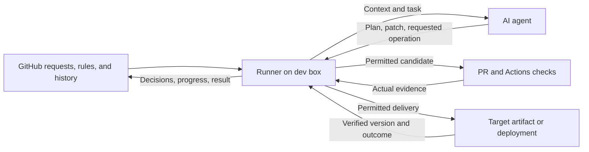
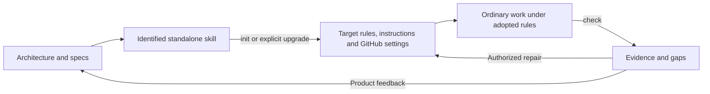
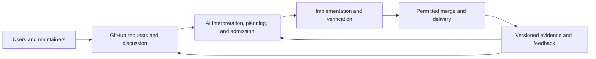
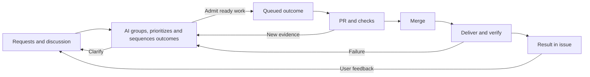

# YOLO Dev adopted protocol

Protocol format: `github-v1` · Candidate L1 distribution

Source: [f9ceb59e5bb6c5e38b01208ef68903b0ffc53664](https://github.com/normzhou/yolo-dev/tree/f9ceb59e5bb6c5e38b01208ef68903b0ffc53664). All required rules and procedures are below; upstream links are optional publisher context or tool documentation. The target supplies its own purpose and accepted authority, not YOLO Dev's Charter. Installing these rules does not qualify or authorize a target. L2 descriptions do not activate an unbuilt runner.

Source status notes describe the publisher at that revision, not this target's setup. This generated document preserves the design text; source links are rewritten to local sections wherever the referenced contract is included. The bundle's `provenance.json` records source digests and selections. Target adoption records retain this source identity and this file's digest.

## Contents

- [architecture](#architecture-adoption-levels)

- [operating-protocol](#operating-protocol-operating-protocol)

- [activities](#activities-agent-activities)

- [repo-layout](#repo-layout-repository-layout)

- [issue-management](#issue-management-issue-management)

- [repo-rules](#repo-rules-repository-rules-and-authority)

- [verification-delivery](#verification-delivery-verification-and-delivery)

- [releases](#releases-product-releases)

- [conformance-checks](#conformance-checks-conformance-checks)

- [qualification](#qualification-compliance-and-qualification-evidence)

- [adoption-records](#adoption-records-adoption-and-evidence-records)

- [github-workflow](#github-workflow-github-operating-workflow)

- [request-interface](#request-interface-request-to-result-interface)

- [request-templates](#request-templates-request-templates-and-fulfillment)

- [onboarding](#onboarding-onboarding-and-check)

- [assisted-development](#assisted-development-assisted-distribution)

- [issue-delivery](#issue-delivery-issue-delivery-runner)

- [observation](#observation-activity-observation)

- [app-hosting](#app-hosting-owner-operated-app-hosting)


<a id="architecture-adoption-levels"></a>
### Adoption levels


| Level | Capability |
| --- | --- |
| L0 · Baseline | AI coding with your own workflow; no YOLO protocol. |
| L1 · Assisted | Maintainer-started harness sessions; AI aligns intent, code and progress through adopted rules/shared records. |
| L2 · Autopilot | Requests automatically reach verified delivery within the grant, without human code approval. |
| L3 · Self-directed | AI identifies useful improvements from use, feedback and maintenance evidence, then delivers them. |
| L4 · Living App | Your app engages users about needs/outcomes, closing use → work → improvement → feedback. |

Ownership does not change across levels; [qualification](#qualification-compliance-and-qualification-evidence) demonstrates capability for a target/revision/route. L1 provides procedural assurance; L2 adds enforced boundaries.

<a id="architecture-system-boundary"></a>
### System boundary

From L2:



AI plans and adapts; the [runner](#issue-delivery-issue-delivery-runner) reconciles context and enforces authority/evidence before operations. Begin on a user-controlled dev box with isolated workspaces and publishing privilege outside candidates. Actions handles automated CI/CD; targets supply delivery access.

GitHub/pushed Git hold durable state. Disposable sessions restart by reconciling existing effects, feedback and pause.

<a id="architecture-agent-interaction"></a>
#### Agent interaction

One repo installation exposes a shared `yolo` skill through [native harness bindings](#assisted-development-harness-bindings), with [init, upgrade, check, request, work, feedback and help](#activities-agent-activities). Bindings pass text to the same procedures; switching harnesses retains adopted rules and shared progress. L1's maintainer starts sessions; L2 automatically starts the same work procedure. Direct conversation steers through shared records; a bypass requires an explicit owner override.

<a id="architecture-execution-identity"></a>
#### Execution identity

The same work procedure uses [explicit access profiles](#adoption-records-execution-profile): existing personal credentials, an operator-owned App on operator infrastructure, or a publisher App confined to publisher infrastructure. The optional encoding and operator App preflight are available to compatible bundles; App-backed worker/publication and hosted execution remain unimplemented. Neither a profile, a bot badge nor installation supplies authority or changes the requested level. User-run workers receive no publisher credentials or generic publisher bot-operation relay.

<a id="architecture-request-surface-and-user-visible-delivery"></a>
#### Request surface and user-visible delivery

Users/maintainers discuss through issues/comments, optionally [inside the app](#request-interface-request-to-result-interface). Feedback UI and the L1 harness share one bridge over GitHub. Requests and work outcomes have many-to-many coverage; decisions, execution and verified availability stay distinct.

[My requests and Work](#request-interface-personal-feedback-and-shared-work) provide owner-filtered conversations and an explicitly app-visible board for authorized signed-in users. The app owns permissions; shared summaries never expose other users' private threads. GitHub holds project state; the app DB holds ownership/intents and disposable projections. Code projects ordinary work updates without model calls on view/refresh or a parallel workflow store. L1 initiation and existing Git/PR/delivery authority remain unchanged.

<a id="architecture-dimensions-of-conformity"></a>
### Dimensions of conformity

| Dimension | Opinion | Contract |
| --- | --- | --- |
| Governing context | Separate intent, design and implementation; complete local rules and ordinary loading. | [Protocol](#operating-protocol-operating-protocol), [layout](#repo-layout-repository-layout) |
| Project management | Shared request intake routes to target/publisher; AI groups inputs into bounded outcomes and manages a recoverable plan, summaries and linked PRs. People steer/contest. | [Issues](#issue-management-issue-management), [workflow](#github-workflow-github-operating-workflow) |
| Authority | PRs with current authorization/evidence; protected approval, ordinary autonomy, identifiable overrides. | [Repo rules](#repo-rules-repository-rules-and-authority) |
| Delivery | Target-defined checks/routes; shared semantic release tags and immutable identities; verify actual delivered outcomes. | [Verification/delivery](#verification-delivery-verification-and-delivery), [releases](#releases-product-releases) |
| Evidence | Preserved identity, context, history and findings; cited capability. | [Records](#adoption-records-adoption-and-evidence-records), [qualification](#qualification-compliance-and-qualification-evidence) |
| Observation | Opt-in native activity records with truthful measurements, separate from work state, reports and feedback consent. | [Observation](#observation-activity-observation) |

Reserve `.yolo/` for governing context, adopted protocol, adoption record and optional reports. [Layout](#repo-layout-repository-layout) defines exact slots/mappings; app and native tooling keep useful conventions.

<a id="architecture-establishing-and-maintaining-conformity"></a>
### Establishing and maintaining conformity



[Init/check](#onboarding-onboarding-and-check) propose/apply setup and review ongoing work. The [standalone bundle](#assisted-development-assisted-distribution) carries enough information for another harness without upstream checkout/chat. The [check catalog](#conformance-checks-conformance-checks) separates deterministic requirements, advisory warnings and agent judgment. The shared validator checks facts; agents review purpose, authority and behavior. Init, upgrade and check converge on the same canonical structure, with dry-run proposals validated before activation. Ordinary loading and both forms of review sustain conformity; L2 also enforces execution preconditions.

Repair the lowest sufficient layer. Target defects stay there; YOLO defects feed back here. Setup, active preparedness and qualification are distinct evidence claims.

Keep product engineering separate from the reusable methodology. YOLO Dev validates its own tooling/bundle and harness behavior under [publisher acceptance](#assisted-development-acceptance); its concrete commands and CI status live in [development instructions](https://github.com/normzhou/yolo-dev/blob/f9ceb59e5bb6c5e38b01208ef68903b0ffc53664/docs/development.md). Each adopted repo defines its own tests and delivery route under the shared [verification contract](#verification-delivery-verification-and-delivery). [Target qualification](#qualification-compliance-and-qualification-evidence) needs that target's actual delivery/continuation evidence; publisher tests cannot supply it.

<a id="architecture-product-source-and-applied-adoption"></a>
### Product source and applied adoption

**Charter → architecture/specs → implementation and published artifacts.**

One co-owned design layer defines shared opinions/acceptance; AI realizes them as skills, helpers, templates, tests and published rules. Targets supply their own purpose/grant. An installed skill and adopted snapshot have separate lifetimes; source/publication changes cannot silently upgrade a pin. YOLO self-use follows the same explicit adoption route.

<a id="architecture-document-homes"></a>
#### Document homes

| Home | Role |
| --- | --- |
| Charter | Human-owned intent/authority for this product. |
| Architecture/specs | Co-owned design/acceptance for protocol, onboarding, distribution and runner. |
| Implementation/artifacts | AI-maintained realizations. |
| README, AGENTS, brainstorm | Visitor explanation, agent entry and exploration/history; ownership follows meaning. |
| Target `.yolo/` and GitHub | Applied context, configuration, work and evidence. |


<a id="operating-protocol-operating-protocol"></a>
## Operating protocol

**The target supplies purpose; YOLO supplies coordinated progress toward it.** The [architecture](#architecture-adoption-levels) connects these contracts. They apply to every adopter, including YOLO Dev, under its own Charter and authority.

<a id="operating-protocol-responsibilities-and-ownership"></a>
### Responsibilities and ownership

| Surface | Responsibility and ownership |
| --- | --- |
| Charter and authority | Humans own purpose, guiding boundaries, recognized maintainers and delegation. [Protected edits](#repo-rules-repository-rules-and-authority) require identified approval or a scoped owner override. |
| Architecture/specs | Humans and AI co-own intended design, behavior and acceptance. Significant changes notify co-owners. |
| Implementation, tests, CI/CD | AI implements, verifies, delivers and maintains within the grant. |
| Issues/PRs | AI manages requests, plans, progress and evidence; input retains its author's authority. |
| Instructions and records | AI connects agents to governing context and records facts; these cannot grant permission. |
| README and exploration | Explain the product and preserve thinking. Neither replaces governing decisions. |

**Information flows both ways; authorization follows ownership.** Human intent guides work; user feedback and delivered results challenge assumptions. Correct the lowest sufficient layer without bypassing its owner.

<a id="operating-protocol-shared-loop-and-boundary"></a>
### Shared loop and boundary



Four obligations govern the loop:

| Obligation | Principle |
| --- | --- |
| Ownership | Read applicable intent, design, instructions and authority; act within the grant. |
| Congruence | Design serves purpose; code realizes intended behavior; tests verify it. Apply YAGNI: the simplest complete solution to an actual need. |
| Verification | Define observable acceptance; verify the actual revision and delivered outcome. Retain failures and limits. |
| Continuity | Keep decisions, evidence and next actions in GitHub/pushed Git; reconcile interrupted effects before retrying. |

AI chooses plans, alternatives and decomposition. Privileged operations require authority and current evidence, not an agent's success claim. See [merge](#repo-rules-repository-rules-and-authority), [delivery](#verification-delivery-verification-and-delivery) and [evidence](#qualification-compliance-and-qualification-evidence) for precise requirements.

<a id="operating-protocol-adoption-levels"></a>
### Adoption levels

[L0–L4](#architecture-adoption-levels) describe capability. L1 uses maintainer-started harness sessions with procedural assurance; L2 adds automatic initiation and enforced boundaries. Higher levels add initiative and app engagement without changing ownership.

<a id="operating-protocol-contracts-and-distribution"></a>
### Contracts and distribution

Keep each decision in one governing home: [layout](#repo-layout-repository-layout), [issues](#issue-management-issue-management), [repository rules](#repo-rules-repository-rules-and-authority), [delivery](#verification-delivery-verification-and-delivery), [records](#adoption-records-adoption-and-evidence-records), [observation](#observation-activity-observation) and [qualification](#qualification-compliance-and-qualification-evidence). [Activities](#activities-agent-activities) and [onboarding](#onboarding-onboarding-and-check) define interaction; the optional [app interface](#request-interface-request-to-result-interface) presents the same records.

Charter → architecture/specs → implementation and published artifacts. The [standalone bundle](#assisted-development-assisted-distribution) realizes these contracts without a second design tier. Targets adopt an identified revision under their own authority; publisher changes cannot silently upgrade it.


<a id="activities-agent-activities"></a>
## Agent activities

**Talk through your harness; coordinate through GitHub.** One skill exposes procedures through the [harness bindings](#assisted-development-harness-bindings), not separate applications or required shell commands. Use the target's active [protocol](#operating-protocol-operating-protocol) and grant; clarify only ambiguous destination or execution scope. Status queries are read-only.

| Activity | Destination | Result |
| --- | --- | --- |
| `init [preview\|ref]` | Target | Propose/apply [adoption](#onboarding-onboarding-and-check); `--dry-run` retains a local preview. |
| `upgrade [preview\|ref]` | Target | Propose migration to latest stable, latest preview or an explicit publication; `--dry-run` previews. |
| `check` | Target | Read-only conformity review, then optional upstream feedback; `--dry-run` proposes isolated repair under the same pin. |
| `request` | Target | Discuss, file or follow an app need or question. |
| `work` | Target | Advance issue-backed outcomes through verified delivery. |
| `feedback` | YOLO Dev | Discuss, submit or follow an upstream problem or improvement. |
| `help [activity]` | Local | Show supported activities, invocation examples and target/upstream distinction; no setup, execution or external submission. |

Work requires active adoption; otherwise prepare init. Feedback needs only installed publisher provenance and reporting authority. An activity absent from an older pin is a capability gap, not permission to upgrade it.

<a id="activities-help-concise-usage"></a>
### Help: concise usage

Bare invocation, `help` without a question and unknown activities return the skill's fixed usage text verbatim. It lists activities and distinguishes target requests from upstream feedback, without inspecting the repo or claiming adoption/qualification. `help <activity>` gives a short paragraph and relevant local reference; expand only to answer a specific question. Help performs no setup, work or external submission.

<a id="activities-request-target-intake"></a>
### Request: target intake

Search related issues, discuss the need, and file/update when authorized. Quick answers need no ticket unless tracking is wanted. Return an actual link or an unsent draft/access gap.

Apply the shared [intake model](#issue-management-intake-and-admission), also used by upstream feedback: classify with an existing `yolo:request` label when authorized; the receiving AI handles missing classification. Explain interpretation/disposition and covering outcomes without mechanical ticket duplication. Request does not start implementation unless execution is requested or standing authority permits it. Follow-up and roadmap questions use the same records.

<a id="activities-work-shared-development-procedure"></a>
### Work: shared development procedure

Accept an issue, desired outcome or direction to continue the plan. Capture the outcome in a target issue before implementation. Planning and execution are one procedure: AI selects the useful phase from current evidence, and an iteration ends at a useful point rather than at a finished outcome.

1. **Reconcile:** load instructions, active rules, mapped intent/design/grant and shared work. Reconcile any [configured outbound request index](#request-templates-authenticated-issue-adapter--145) through authenticated response reads, including post-closure follow-up; no index is selected merely by installing a skill. Check replies, later reversals, PRs, checks, delivery, pause and executor/handoff; resolve interrupted effects, inspect an external action's actual result before repeating it and coordinate writers. Superseded decisions are history, not current intent.
2. **Select, then admit when needed:** choose one useful objective or small coherent batch with a sensible stopping point and perform the [planning pass across requests/outcomes](#issue-management-planning-across-outcomes). Interpret input from dissatisfaction to a precise proposal — investigate, assume reversibly, consolidate or split, defer or decline with a reason — then record the [admission handoff](#issue-management-intake-and-admission) before executing, or publish another disposition. Admit a bounded investigation with an evidence goal when the solution is materially unknown. Admission is an AI decision within the grant, not a requester sign-off. [Maintainer-reserved actions](#issue-management-maintainer-reserved-actions) stay visible as blockers but are never selectable executable outcomes. Record grouping, priority/dependencies and a discoverable Now/Next when coordination spans outcomes. Apply protected-change approval/significance notification rules.
3. **Advance:** maintain issue state/summary, implement through [PRs](#repo-rules-repository-rules-and-authority), verify and [deliver](#verification-delivery-verification-and-delivery) within the admitted bounds. Material new evidence returns the same agent to interpretation/admission; record revised acceptance and the original scope's disposition before executing the revision.
4. **Publish and continue or hand off:** synchronize the affected issue/plan records and pushed work, then record the [iteration](#issue-management-progress-planning-and-feedback) with its actual result, evidence, remaining scope, next action and any operation still running. Keep unfinished scope visible and close fulfilled work only after verification. If publication fails, retain the local result and report exactly what remains unsynchronized instead of claiming continuation is ready. A fresh harness or empty workspace continues from those records and pushed Git; a session ending does not prove its executor stopped.

Ordinary development requests enter this procedure without naming the skill. Conversation is steering; bypass requires a scoped [owner override](#repo-rules-owner-overrides).

L1's maintainer starts sessions; AI may admit and plan within them. Between sessions there is no independent YOLO intake/scheduling, though started CI/CD may continue. L2's [runner](#issue-delivery-issue-delivery-runner) initiates this same procedure with enforced preconditions.

<a id="activities-observation-automatic-activity-records"></a>
### Observation: automatic activity records

An opted-in and natively bound harness may [observe](#observation-activity-observation) an explicit activity's execution automatically: correlated `started`/`finished` events with native measurements and an allowlisted projection of the ordinary report. Observation is separate from feedback consent, defaults off, observes without adding prompts or gates, and never replaces the report, advances a checkpoint or qualifies the adoption. An activity absent from a pin that lacks an observer remains a coverage gap, not permission to upgrade it. Dry runs and non-consenting repositories emit nothing.

<a id="activities-feedback-upstream-yolo-interaction"></a>
### Feedback: upstream YOLO interaction

Resolve upstream from adoption/bundle publisher provenance; never default to the target's origin. Search related issues/plan and prefer existing threads. Keep target requests in the target repo.

This is a request to the publisher: use the same intake classification and receiver-managed planning, not a separate feedback queue. Apply an existing `yolo:request` label when authorized and available; otherwise file normally and leave classification to the receiver. Never configure the upstream repository from a target harness.

Draft useful bugs, questions or improvements arising from actual use of YOLO: unclear, conflicting or ineffective guidance, tooling failures or unnecessary friction. During check and the final init/upgrade assessment, briefly consider these causes; ordinary target defects and successful checks need no upstream report. Separate observed evidence from hypotheses.

**Default: draft → show destination/content → ask the harness user → submit if authorized.** When only in-session consent is missing, prepare that reviewable draft and ask directly; do not replace the submission with a manual copy-and-post issue. Use [maintainer-reserved handoffs](#issue-management-maintainer-reserved-actions) only for a genuine unavailable/reserved prerequisite. Group the same cause in one issue; search before filing, reuse related threads and add only substantive new evidence. Sanitize before showing or sending: exclude target identities, code, URLs, paths, raw logs and credentials. Include only YOLO release, relevant harness/activity, expected versus observed behavior, impact and a safe reproduction when available.

An active target may opt into automatic submission through its [adoption record](#adoption-records-adoption-and-evidence-records). A recognized maintainer must explicitly accept that scope at an identified revision; the flag alone grants nothing. Check the active pin, accepted consent and governing restrictions before using it. This permits only the sanitized feedback above to the provenance-identified publisher, never broader telemetry or target disclosure. Without valid consent, retain drafts and ask. **Dry runs never submit**, regardless of the setting.

Keep assessment read-only; any authorized submission is a separate, visible feedback step. Confirm its actual issue/comment link, or retain an unsent draft with the access gap. Submission implies no admission or ETA; upstream fixes require explicit target upgrade and unavailable access does not block unrelated work.

<a id="activities-acceptance"></a>
### Acceptance

Demonstrate the activities from a standalone bundle: read-only help/status, shared intake without premature admission, multi-request grouping/sequencing with durable planning and source coverage, direct harness work with fresh continuation, and upstream routing with default consent, accepted automatic opt-in, draft-only dry runs and no unauthorized submission/disclosure. Use [qualification](#qualification-compliance-and-qualification-evidence) for level claims.


<a id="repo-layout-repository-layout"></a>
## Repository layout

**Reserve `.yolo/`; preserve useful app and native tooling layouts.** This defines the compliant state; [onboarding](#onboarding-onboarding-and-check) reaches it.

```text
.yolo/
  governance/
    CHARTER.md
    AUTHORITY.md
    ARCHITECTURE.md
    specs/          # Optional durable behavior contracts
  protocol.md
  adoption.json
  reports/          # Optional file-based evidence/proposals
```

| Surface | Meaning |
| --- | --- |
| Charter | Human-owned purpose, goals and durable guiding boundaries. |
| Authority | Human-owned recognized maintainers, delegation, reserved decisions and limits. |
| Architecture/specs | Co-owned intended design, behavior and verification/delivery route. |
| Protocol | Complete locally available rules at an explicitly adopted source revision. |
| Adoption | AI-maintained identity, mappings, status and history/evidence references; see [records](#adoption-records-adoption-and-evidence-records). |
| Reports | AI-maintained evidence/proposals, including unresolved questions; issues/PRs remain the primary work interface. |

<a id="repo-layout-reserved-namespace"></a>
### Reserved namespace

Names and types are exact and case-sensitive. Only the tree's entries are allowed inside `.yolo/`; names/subdirectories within specs/reports are target-defined. Create optional directories only for content. App code, installed skills, caches, credentials, parallel issue databases and ephemeral [observation](#observation-activity-observation) counters/correlation stay out.

All three governing documents use the canonical slots above; durable governing specs use `.yolo/governance/specs/`. Existing documents are migration inputs, not permanent location exemptions. Preserve their accepted meaning while moving them, update active references and native tooling that depends on those paths, and remove competing active copies. Active governing/instruction links must agree with those mappings; migration is a move, not a parallel document tier. Historical evidence retains its original content and cited revision. Earlier pins keep their earlier rules until an explicit upgrade.

Questions belong in reports/issues, not extra governing files. Ownership follows meaning, including draft Charter/authority and proposed controls; location cannot grant permission.

The adopted source revision identifies the layout contract. The [schema](https://github.com/normzhou/yolo-dev/blob/f9ceb59e5bb6c5e38b01208ef68903b0ffc53664/specs/repo-layout.schema.json) supplies its reserved entries/types/role paths in the manifest. The strict validator reports missing canonical homes, unexpected entries, wrong types and invalid mappings without changing files. Init/upgrade propose the required repair; do not mark setup prepared while required structure fails. An incompatible/missing definition is a coverage gap; structural success does not prove meaning or approval.

<a id="repo-layout-governing-file-review"></a>
### Governing-file review

Check each canonical governing slot independently: exact spelling, regular non-symlink file, nonempty content and matching role mapping. Then inventory files with the same basename (case-insensitive) elsewhere using Git's tracked and unignored working files. Ignored untracked dependencies/builds and nested repos are outside this scan; tracked artifacts still count. Report candidate path, canonical role, file/symlink type and byte equality when safely readable. Never follow a candidate symlink outside the repo.

Filename or byte equality is a **review signal**, not a ban or deletion instruction. Before completing init/upgrade/check review, classify every candidate with content/reference/history evidence: unintended active replica, intentional non-governing template/fixture/history/distinct scope, or unresolved. Preserve intentional artifacts; reconcile replicas through an authorized move and reference/tooling repair. Unknown purpose stays unresolved. Record classifications in the normal report; no permanent allowlist is required.

Review ordinary entrypoints and README too. Calling this repo's own Charter/design “publisher source” does not establish an independent role or justify copies that may drift. Reusable methodology implementation and installed rules remain separate artifacts; this distinction cannot create two governing homes for the same decision. Use [the consistency checklist](#onboarding-proposal-review); structural success cannot clear semantic candidates.

<a id="repo-layout-native-entrypoints-and-ordinary-context"></a>
### Native entrypoints and ordinary context

Keep source, tests, assets, builds and package entrypoints in useful target locations. Keep harness/GitHub entrypoints native, such as `AGENTS.md`, `.agents/skills/` and `.github/workflows/`; the [shared bundle and command bindings](#assisted-development-harness-bindings) stay outside `.yolo/`. Preserve other active instructions. README links the governing documents.

Ordinary instructions require agents to read/apply the local protocol, adoption and mapped context before work, even without invoking the skill. Harness-specific bridges expose that same context, not independently authored rules.

<a id="repo-layout-instruction-provenance"></a>
#### Instruction provenance

`AGENTS.md` connects ordinary sessions to adopted rules and mapped context. Its path, a generated template or agent authorship establishes neither owner acceptance nor file-wide ownership. AI maintains loading, references and implementation guidance within the grant; purpose, delegation and controls retain their ownership wherever written.

Link durable purpose and authority decisions to their governing homes instead of repeating them as independent instructions. During semantic review, trace substantive instructions to accepted source revisions/evidence. When the source is clear and the wording is an unsupported derived restatement, repair the instruction to reference that source while preserving the accepted decision. Stronger or conflicting derived wording is an instruction-conformity finding with no independent governing force. If the instruction itself records an accepted purpose or authority decision, preserve its meaning and follow protected-change rules for amendment or relocation. Unknown provenance remains unresolved; investigate before the affected action without inferring acceptance or discarding a possible owner decision.

<a id="repo-layout-integrity-and-continuity"></a>
### Integrity and continuity

Rules must work without upstream checkout, prior chat or live fetch. The local snapshot has a committed source identity, digest and working local references. Skill replacement/removal cannot alter the pin; upgrades/history preservation follow [records](#adoption-records-adoption-and-evidence-records) and [onboarding](#onboarding-repeat-init-and-upgrade). Existing `.yolo-dev/` installations retain their pin until explicit migration.

File presence is only one dimension of [qualification](#qualification-compliance-and-qualification-evidence); issues, effective repository settings and actual delivery also require review.


<a id="issue-management-issue-management"></a>
## Issue management

**People describe needs; AI manages work.** Product requests, CI/CD and maintenance share GitHub issues/PRs.

Issue policy: `request-outcome-v2`.

<a id="issue-management-intake-and-admission"></a>
### Intake and admission

Target `request` and upstream `feedback` use the same intake model in different receiving repositories. Their routing, consent and authority remain distinct. AI classifies incoming needs/questions/evidence with `yolo:request`, including unlabelled issues and substantive new replies. Authorized submitters may apply an existing label; missing label permissions do not block filing or authorize repository configuration changes.

Intake is not admission. AI interprets requests and records disposition before queuing outcomes. Several requests may inform one bounded outcome; one request may require several. Promote a source issue in place when it already expresses that outcome, retaining `yolo:request`; otherwise link sources to covering work. One `yolo:work` issue represents one outcome and may have several PRs. Do not create a second ticket mechanically or group unrelated work merely by arrival time.

Before admission, maintain at most one summary comment headed `## YOLO request`: interpretation, decision/reason, covered and remaining scope with outcome links, and next action or reconsideration condition. No summary means awaiting triage, not scheduled work. After promotion, use the work summary for current status and preserve earlier triage as history. AI verifies authorship/content; a heading proves neither review nor authority.

Admission is executable when the outcome record carries:

| Admission information | Meaning |
| --- | --- |
| Outcome and sources | Useful behavior/result and original request links, including coverage of grouped or split requests. |
| Scope and decisions | Intended changes, meaningful exclusions, assumptions and settled constraints. |
| Acceptance and delivery | Observable success, required checks and the destination/availability actually to verify. |
| Charter fit and authority | Why the outcome advances the Charter, applicable grant/decision references and any protected prerequisite. |
| Readiness | Dependencies, risks and open questions that prevent execution or could change the outcome. |

That is enough intent to implement without repeatedly reconsidering product strategy; it does not freeze ordinary technical choices. A protected-dependent portion stays unready until its decision resolves, while independently authorized work continues.

Keep distinct source requests open while their promised scope is unfinished. Close verified fulfilled scope as completed, or duplicate/declined/answered input with an explicit disposition and canonical links where applicable. Consolidation, a plan or a merged PR does not prove delivery. Read later replies, including closed issues, and reopen or link follow-up without erasing earlier results.

Reconcile current intent from applicable authenticated direction, including later reversals. Superseded decisions remain history, not current authorization. Unresolved consequential contradictions block the affected work.

<a id="issue-management-reserved-labels-and-states"></a>
### Reserved labels and states

Preserve unrelated labels. AI maintains:

| Label | Meaning |
| --- | --- |
| `yolo:request` | Incoming need, question or evidence; no execution commitment. Retained when promoted or closed. |
| `yolo:work` | Admitted AI-managed outcome with acceptance, progress and evidence. |
| `yolo:manual` | Action reserved to a recognized maintainer; tracked as a blocker, never AI-executable. |
| `yolo:state:queued` | Ready and authorized, with clear acceptance/next action. |
| `yolo:state:active` | Work underway, including diagnosis, recovery or replanning. |
| `yolo:state:waiting` | Named dependency, information/authority gap, pause or binding limit blocks progress. |
| `yolo:state:deferred` | Postponed with a reason and reconsideration condition. |

After reconciliation, open managed work has exactly one state; closed work retains `yolo:work` and no state. Requests without `yolo:work` have no execution state. A `yolo:manual` issue is never `yolo:work` and carries no state label; either combination is a conflict to reconcile, and a closed manual task keeps `yolo:manual` with no state. AI-originated maintenance outcomes need no invented source request. Planning/general conversations need no request or work label. Interrupted metadata updates establish neither permission nor completion.

Filter intake with `is:issue is:open label:"yolo:request" -label:"yolo:work"`; it includes reviewed sources tracked by other outcomes. Review summaries/replies to distinguish new input. Filter admitted work with `is:issue is:open label:"yolo:work"` and a state label. Manual tasks surface through their blocked work rather than through the work filter, so they stay visible without becoming selectable outcomes. Build/test/deploy stages need no additional labels.

Init/upgrade establish this version's required labels and reconcile the target's existing maintainer-reserved actions. Earlier pins retain earlier requirements, so a target without `yolo:manual` is not a gap; a request or manual label alone supplies no new authority or workflow state.

<a id="issue-management-maintainer-reserved-actions"></a>
### Maintainer-reserved actions

Use `yolo:manual` for a genuine maintainer prerequisite: an explicitly reserved decision/action or setup unavailable to the authorized agent, such as account consent, credential access or a protected approval. Distinguish this from routine work that only awaits consent in the active session. Prepare the concrete proposal, destination and content, ask there, and use the authorized tools after consent; do not make the maintainer copy a submission or run agent-executable commands. An unresolved reserved prerequisite can still need a durable manual issue. Consent does not waive a protected procedure or expand the grant.

Before handing work over, complete the authorized preparation and discovery. Reconcile existing accounts, resources and private access through permitted tools; derive identifiers and assemble inputs/configuration instead of assigning those chores to the maintainer. Prepare private directories or keys only within existing authority and agreed secure storage/custody. Preserve bound credentials, keys, state and completed setup; never generate replacements or broaden access just to simplify a handoff. For provider-controlled steps, check current official instructions and choose the simplest suitable scoped flow or template, verifying its actual permissions rather than assuming the template grants them.

Keep one self-contained instruction home in the manual issue. Start with **why the maintainer is needed** and **what progress is blocked**, name the maintainer assignee, then give the smallest remaining action and observable completion condition. Include the current provider reference and a private handoff mechanism when relevant, never secret values. Search and reuse the existing task; update its current instructions as evidence changes. Routine chat/status updates link to it instead of repeating setup scripts; answer specific clarification or owner requests as needed.

AI coordinates the reserved action, verifies its result and continues independent ready work meanwhile. It does not perform a human-reserved step or convert its authorized preparation into a human chore. Assignment and labels grant no authority, and same-account agent authorship is not proof of human approval.

Block genuinely blocked work with native `blocked by` relationships. Use `yolo:state:waiting` only while a real prerequisite prevents progress, recording the blocker and next action in the work summary and plan. Missing or invalid dependency metadata, no declared dependency, or all declared blockers closed requires agent reconciliation, not automatic resumption or a deterministic conflict. Closure may still need confirmation, evidence or replanning; waiting can also reflect a pause or authority gap. Keep explicit links when native relationships are unavailable and report the coverage gap. Retain satisfied dependency links as history.

Verify before resuming. Closure alone does not prove the action happened: reconcile explicit maintainer confirmation and observable completion evidence under the repository's identity and authority rules. A declined or withdrawn action causes replanning, not automatic resumption. AI may close a satisfied manual task after that reconciliation and must never claim to have performed the human action.

Reserve manual tasks for genuine owner actions, authority decisions and unavailable human-controlled setup. Ordinary authorized implementation, testing and delivery stay AI-owned; this classifier creates no new approval gate. Keep credentials and other secrets out of issues, reports and source.

<a id="issue-management-planning-across-outcomes"></a>
### Planning across outcomes

At work startup and material changes, reconcile active execution/results, incoming requests/replies, dependencies and maintainer steering. Consolidate evidence, define useful bounded outcomes, select authorized work and explain ordering using Charter value, impact, risk, uncertainty, dependencies and effort. Frequency is evidence, not authority; no fixed scoring algorithm or oldest-first rule is required. Ask about consequential missing direction; use AI judgement for ordinary reversible choices.

For one outcome its status summary suffices. When coordination spans outcomes, maintain one discoverable planning issue linked from affected work/request summaries; reuse the L2 control issue when applicable. Its current summary records focus, ordered **Now / Next**, reasons, blockers and material changes. Work issues own execution state/evidence; do not duplicate them or create a mandatory board, roadmap file or approval cycle. Queue order is not an ETA.

Replan after failures, discoveries or changed steering; preserve earlier intent/failure and coordinate interruptions under the execution protocol. Advance independent ready work while blocked, explain deferral and reconsideration, and revisit neglected input. L1 planning occurs in maintainer-started sessions; L2 may initiate it automatically. Neither receipt nor a label guarantees admission or a response time.

Before executing revised scope, record its acceptance and the original scope's disposition in the current outcome and affected sources. A substitute result does not fulfill abandoned scope or satisfy its prerequisites. Replanning stays within ownership and authority.

<a id="issue-management-progress-planning-and-feedback"></a>
### Progress, planning, and feedback

Maintain one summary comment per outcome, headed `## YOLO status`:

```text
Outcome: intended result and source links
Acceptance: observable success
Plan / next: approach, blocker or reconsideration condition
Work: executor/attempt, branch/PR, revision and stage
Evidence / result: checks, delivered version/destination, user action and limits
```

Edit that same comment as work progresses; ordinary dated comments retain decisions/history without the status heading. Reconcile its executor, branch/PR, stage and next action with actual records when those change. An old issue body or superseded comment is not the current plan.

`Acceptance` carries the admitted scope and authority reference, `Work` the iteration identity, executor and branch/PR/revision, and `Evidence / result` the actual result, remaining scope and next action. Link detail from the iteration record instead of growing an unbounded template.

One coherent iteration records its identity once, in the outcome's current summary or a dated continuation comment — or in the plan issue for planning-only work:

```text
Iteration: <id>; profile: <personal | self-hosted-app | hosted>
Executor: <observed operator/principal>; harness: <name/version or unknown>
Trigger / authority: <source>; <active protocol and grant/decision references>
Objective / outcome: <chosen chunk>; <actual result and evidence links>
Continuation: <remaining work, next action, pushed revisions, active operations/limits>
```

Further issues link to that one continuation home instead of starting a per-harness ledger. New YOLO-written bodies, comments and release notes carry a concise marker — `Created by YOLO Dev · mode: <profile> · harness: <name/version> · run: <iteration id> · <record link>` — and an AI contribution to human-authored text uses `Updated by`, retaining its source and authorship. The marker declares provenance only: it is no evidence that YOLO ran correctly or that an operation was human-approved, labels cannot identify individual comments, and `yolo:work` continues to mean admission.

Mark unknowns. A heading or user success claim is not execution evidence. Dated comments preserve material decisions, changed scope/priority, failures, handoffs and results. Reply at source requests; explain declined/deferred scope and link release updates to verified versions. Split requests summarize delivered, remaining and declined outcomes.

Use native sub-issues/dependencies for actual decomposition/blocking. Update source requests for changed disposition/coverage and verified results; routine execution detail stays on linked work. Forecasts need supporting evidence and uncertainty.

<a id="issue-management-l2-coordination-and-recovery"></a>
### L2 coordination and recovery

L2 adds one open `yolo:control` issue, linked by adoption: Now/Next, Run/Pause and authenticated steering/handoff links. This is the only extra L2 label. Human pause lasts until explicit human resume.

Start with one coordinator and one writer per outcome. Record executor and acknowledged handoff before overlapping writes; labels, assignees or inactivity do not prove termination. Harness intervention uses the same protocol. Reconcile shared GitHub/Git/check/delivery state after interruption; no runner-side durable queue or cross-object transaction is required.

Retry only with new evidence or justified transient cause; otherwise reassess. AI may repair, change approach, replan, wait/defer or propose governing changes. Preserve prior intent and failure; explain revised acceptance prospectively at the source. No universal retry count is imposed; binding limits survive restarts and split work. [Delivery](#verification-delivery-verification-and-delivery) defines completion/recovery evidence.


<a id="repo-rules-repository-rules-and-authority"></a>
## Repository rules and authority

**Ordinary work uses PRs; authorization follows ownership.** Accepted owner/team policy identifies recognized maintainers. GitHub identity/permissions support it; a role, label or AI summary cannot expand the grant.

<a id="repo-rules-changes-and-merge"></a>
### Changes and merge

| Change | Rule |
| --- | --- |
| Charter, authority or authority controls | All edits need authenticated human approval of the proposed revision or a scoped owner override. |
| Architecture/specs | AI reviews congruence/significance. Shared behavior, boundaries, adoption requirements or delivery guarantees notify mapped co-owners with impact before merge and again at landing; no acknowledgement wait within the grant. |
| Implementation, tests, CI/CD | AI owns routine decisions/delivery within bounds; no human code-review gate. |

Every ordinary change uses a PR referencing its outcome issue. Use `Refs #42` while delivery is pending; merging must not close undelivered work. One outcome may span PRs.

Before merge, reconcile exact head/base, feedback/pause, accepted authority, correctness/congruence/significance review and [required checks](#verification-delivery-verification-and-delivery). Failed, missing, unknown or stale required evidence blocks the action.

Approval binds to the current proposed revision; further edits invalidate it. Accepted base policy identifies approvers: candidates cannot add an approver, expand their grant or certify their own authority gate. Historical cosmetic exceptions apply until an authorized upgrade; publisher text cannot amend a target Charter.

The grant, Charter and adopted protocol must agree about each affected action. Conflicting delegation/reservation or a local exception to the active rules blocks that action until recognized clarification, amendment or a scoped override; AI judgement cannot resolve it by choosing the more permissive text.

<a id="repo-rules-identity-and-provenance-records"></a>
### Identity and provenance records

Record each fact at its own source and keep it separate from the claims made about it:

| Fact | Recorded source and limitation |
| --- | --- |
| Requester | Original author ID and source URL, or an explicitly verified external source. Bot quotation does not become a human instruction. |
| Observed role and authority | Permission evidence at decision time plus the target's recognized-maintainer/owner policy. Role alone supplies no Charter authority, and unknown stays unknown. |
| Initiation | Maintainer-started, automatic intake/resume or AI-originated improvement, retaining the initiating source. |
| Execution | Declared profile, actual operator/principal and harness/version when observed. Commit author fields are separate metadata. |
| Permission to act | Active protocol/grant revision and any applicable human decision, pause or override. |
| Result | Actual operation receipts and version/check evidence, separated from agent-reported claims and missing observations. |

Use stable IDs for authorization bindings and names or URLs for explanation. Re-evaluate authority when an operation needs it and preserve historical authorship if access later changes. Do not infer owner authority from an issue's author association, an email address, an organization name or an App installation.

Authenticated personal-account authorship can represent a person or a harness using that account, and a marker cannot resolve that ambiguity. Protected approval follows the target's accepted confirmation route, binds to the identified current revision and cannot come from the automation it governs; L1 retains procedural assurance and explicit limits.

<a id="repo-rules-enforcement-by-level"></a>
### Enforcement by level

L1 requires procedural conformity and cited evidence. L2 additionally proves effective controls for PR routing, required evidence and protected approval. Automation has a distinct identity, no authority-administration or bypass privilege.

Prefer native GitHub rules/permissions. Record each enforcement binding and gap; files or declared settings cannot prove refusal. Selective approval remains to be demonstrated before L2; blanket human review defeats ordinary autonomous delivery. No particular ruleset, branch, merge strategy or approval bot is prescribed.

<a id="repo-rules-owner-overrides"></a>
### Owner overrides

Record authenticated owner, reason, affected rule, scope and revision in an issue/PR; link landed history with `YOLO-Override: #N`. Prefer PRs. Emergency direct actions retain equivalent evidence and old/new tips. Check matches action to scope; unexplained bypass is a finding.

AI maintains configuration within the grant. Authority-control changes retain human ownership regardless of file location; installation cannot supply bypass or publication privilege.


<a id="verification-delivery-verification-and-delivery"></a>
## Verification and delivery

**Verify the delivered outcome, not just the work that produced it.** Target architecture/specs define proportionate checks, destination/version observation, recovery scope and binding limits. AI owns testing, CI/CD and maintenance within that grant; no universal suite, service or retry budget is imposed.

This reusable contract governs evidence and delivery, not test implementations. Each target chooses its suites, build commands and workflows; it does not inherit YOLO Dev's own bundle tests or release tooling.

<a id="verification-delivery-checks-and-github-actions"></a>
### Checks and GitHub Actions

Record candidate/relevant base, acceptance, check source, actual runs/results and limits. Required evidence must pass on the current subject before dependent merge/delivery; failed, missing, unknown or stale evidence blocks it.

Use GitHub Actions for automated CI/CD, retaining useful workflows. L1 may use cited harness-run checks; L2 needs trustworthy automated evidence and effective controls. Do not add placeholder jobs. AI may improve verification, but evaluate replacements under incumbent accepted requirements before activation. Candidate tests/reports cannot replace the authority gate.

<a id="verification-delivery-delivery-and-completion"></a>
### Delivery and completion

Follow the shared [release convention](#releases-product-releases): semantic release tags, immutable identity, mapped native versions and preserved migration history. Targets choose their release tooling and cadence within authority.

Record revision/action/destination intent before merge/publication and actual results afterward in native PR/check/release/deployment records and issue summaries. Reconcile uncertain effects before retrying or dependent actions.

| Evidence | Establishes |
| --- | --- |
| Passing checks | Identified checks passed on their subject, within stated limits. |
| Merged PR | Code reached the target branch. |
| Artifact/deployment | An identified version reached a destination. |
| Verified outcome | Acceptance passed on that delivered version/destination. |
| Current availability | The relevant app/client currently serves it, supported by current version evidence. |

Close fulfilled work only after delivered verification. Link version/destination, acceptance, access/update steps and limits; release updates identify the verified version. App interfaces follow the optional [interface contract](#request-interface-request-to-result-interface).

Use the outcome's declared delivery route: verification in a development checkout does not establish availability through an advertised package, tag or deployment. A local checkout can itself be the agreed destination; state that scope explicitly. Otherwise keep work open through publication and verification of the version users obtain.

<a id="verification-delivery-failure-and-maintenance"></a>
### Failure and maintenance

Use the [adaptive work loop](#issue-management-l2-coordination-and-recovery): diagnose, recover/change approach, replan, wait/defer or propose governing changes. Keep work active while authorized progress is possible; waiting names a real constraint. Separate issues serve independent outcomes.

Retain prior intent/failures; revised acceptance is prospective. Recovery cannot expand authority. Reconcile rollback/current availability without erasing historical delivery. Pause and binding limits survive restart.


<a id="releases-product-releases"></a>
## Product releases

**Every YOLO-enabled product uses immutable `vMAJOR.MINOR.PATCH` release tags.** Optional [SemVer](https://semver.org/) prereleases, such as `v0.2.0-alpha.1`, are allowed; native app/package versions omit `v`.

Target architecture/specs define the compatibility promise, native version source and delivery route. Stable releases increment major for incompatible changes, minor for compatible capabilities, patch for compatible fixes. Before 1.0 compatibility is experimental; breaking changes still explain migration. AI chooses cadence and bumps within its grant; changing the major version supplies no additional authority.

Published tags and contents are immutable. Corrections use new versions. Record tag, full commit, delivered artifact/destination, verified acceptance and update/migration steps; rollback identifies the restored version. A tag proves neither delivery nor current availability. Changes may be batched; commits/deployment attempts retain their own identities. Reuse native version files and delivery records, without an extra reserved file or mandatory per-deployment GitHub Release.

At release, the native version at the tagged revision and in the delivered artifact must match the tag. HEAD may carry an unreleased version; changing it cannot repair an already-published mismatch. Preserve that discrepancy and prepare a consistent next unused version, publishing only when verification and authority permit.

<a id="releases-establish-and-check"></a>
### Establish and check

Release history: `recoverable-v1`. Earlier bundles without this profile retain their earlier checks.

Init proposes the smallest release-policy/version-source migration. AI selects the existing native source where suitable; this routine binding does not require a new human decision. Preserve existing compatible versions; default new products to `0.1.0-alpha.1`. Record when the adopted convention became applicable and the exact earlier product tags/commits; those retain their earlier rules, including any existing target policy. An older mention of versioning cannot backdate newly adopted requirements. Later migrations preserve established boundaries and identify new requirements in their upgrade evidence. Every subsequent product release conforms. Other tooling tags can coexist, with their purpose reviewed.

Unreleased projects declare their initial version and unreleased status. Prepared setup requires mapped policy and a valid native version; do not manufacture publication. Q4 demonstrates tagged, verified release when product publication is in scope. Local-checkout-only delivery remains explicitly scoped.

Explicit upgrades reconcile the same policy, releases and history in their migration. Updating the YOLO installation alone does not bump the target product. Dry runs create no remote tags/releases; publication remains within existing authority.

Read-only check reviews default-branch setup, current release records and the interval since effective adoption/checkpoint. Factual checks observe names, tag/commit mappings and changes to retained observations. AI verifies native versions, artifact identity, compatibility bumps, migration and delivery. Persist dated tag/commit observations in ordinary evidence records; current refs cannot prove historical immutability. Missing evidence stays unverified; violations need cited resolution, not rewritten tags/history.

Preserve the first established applicability boundary; restoring it after erroneous intermediate records is a repair, not a new boundary. Compare retained mappings by immutable commit identity: an annotated tag object may be corrected to the commit it peels to, never to another commit. Keep every prior mapping/reference and the erroneous history, with the correction explained in a later report. Missing objects or an incorrect first establishment require investigation; current refs alone cannot validate a correction or authorize moving applicability.

The [record encoding](https://github.com/normzhou/yolo-dev/blob/f9ceb59e5bb6c5e38b01208ef68903b0ffc53664/skills/yolo/references/records.md) realizes these bindings. Target product versions and adopted YOLO releases are independent; upstream publication never upgrades a target automatically.


<a id="conformance-checks-conformance-checks"></a>
## Conformance checks

**Programs check facts; agents judge meaning. Both are required.** This reusable catalog applies under the target's adopted version. Linked contracts define the details.

<a id="conformance-checks-deterministic-checks"></a>
### Deterministic checks

The read-only validator implements these tests. Deterministic violations cannot be waived; missing observations remain unverified. L1 is procedural: a check is not an enforced merge gate. [L2 controls](#repo-rules-enforcement-by-level) require separate evidence.

| Check | Required fact |
| --- | --- |
| [Layout](#repo-layout-repository-layout) | One active adoption marker; exact reserved slots/types; nonempty mapped governing documents; specs in their canonical home; no unexpected reserved entries or escaping paths. |
| [Rule identity](#assisted-development-information-delivery) | Snapshot, provenance, manifest and complete skill inventory match recorded digests/publication bindings. |
| [Agent entrypoints](#assisted-development-harness-bindings) | Native bindings/imports are intact; instructions reference local adoption/protocol; checked governing Markdown links resolve to mapped homes. |
| [Record encoding](#adoption-records-adoption-and-evidence-records) | Required context/migration fields and references have valid shape; feedback settings are boolean with consent references when enabled; compatible optional execution profiles/IDs/setup references are valid, without inferring hosted enrollment or falling back to personal access for an App declaration. |
| [History](#adoption-records-reports-and-checkpoints) | Baseline/checkpoint ancestry, report chain and interval identities agree; recorded unresolved findings prevent factual readiness; checkpoint/report history remains intact. Compatible adopted bundles permit exact, visible supplemental historical findings without waiving existing failures or subject verification. |
| [Issues](#issue-management-reserved-labels-and-states) | Adopted-policy labels exist; states require `yolo:work`; managed open issues have one state, closed issues none; manual tasks carry neither work nor state and open tasks name a recognized maintainer assignee; dependency counts for waiting work are observed, with missing/invalid data, no declarations or all-closed blockers reported unverified for reconciliation; each outcome has one status summary, each classified request at most one request summary. |
| [Releases](#releases-establish-and-check) | Release bindings/effective history exist; product-tag candidates follow naming rules; published releases have tags; retain mappings/references. Under `recoverable-v1`, current applicability equals its first establishment and historical tag objects compare by peeled commit; other commit changes remain gaps. Earlier pins keep their checks. |
| [Default branch](#qualification-required-observations) | Declared branch matches GitHub; landed adoption identity agrees with inspected setup. Unavailable/unpublished context remains unverified. |

`--structure` covers local layout, identity, entrypoints and structural encoding. Full check adds context/history and GitHub facts; offline leaves remote checks unverified. Earlier pins retain their coverage. Findings: `compliant/missing/conflicting/unverified`. Structure: `pass/fail/unverified`. Exits: 0 ready for review, 1 gaps, 2 invocation/Git error.

The validator observes repository settings; it does **not** authenticate approval/provenance, judge document/report/summary contents, inspect every PR review/check, validate native versions, execute target tests or prove delivery. Agents reconcile that evidence.

The publication manifest identifies the adopted issue-management policy. `request-outcome-v2` requires `yolo:request` and `yolo:manual`, and observes native issue dependencies; `request-outcome-v1` requires only `yolo:request`. Earlier pins retain their label requirements, so a target lacking `yolo:manual` is not a failure under `v1`, and the classifier may coexist with older rules without granting execution. Missing or conflicting facts are findings; an unobservable assignee, comment, or dependency summary is unverified rather than compliant — including waiting work that declares no native dependency, whose block may be real but cannot be evidenced. Zero request summaries means awaiting triage, not a deterministic failure; identifying unlabelled input, review/disposition quality, coverage, plan discoverability and sensible ordering require agent judgment.

<a id="conformance-checks-advisory-warnings"></a>
### Advisory warnings

Matching-name governing files are **review candidates**, not automatic violations. `replica_candidates` provides paths/type/byte comparison. Candidates alone do not fail structural checks; an incomplete inventory is unverified.

Classify each from content/references/history: active duplicate, intentional template/fixture/history/distinct scope, or unresolved. Record evidence and an authorized next action. Preserve intentional artifacts; never delete or exempt by filename alone. Confirmed active duplication fails conformance; unresolved required review prevents a conformance claim.

Flag other ambiguity for judgment. Warnings cannot waive an underlying requirement.

<a id="conformance-checks-agent-judgment"></a>
### Agent judgment

Record **pass / fail / unverified, evidence and next action** for each review:

| Review | Question |
| --- | --- |
| Purpose and congruence | Do all layers serve confirmed goals, with concise documents, one governing home and correct active references? |
| Ownership and authority | Do grant, Charter and pin agree? Are approvals authentic/revision-bound, significant changes notified and overrides scoped? |
| Work and adaptation | Are intake and committed outcomes distinct, with justified grouping, source coverage and recoverable Now/Next/dependencies? Do replies, actual progress, closures and replanning remain truthful, including neglected input and failures? |
| Verification and delivery | Are checks trustworthy/current, versions and compatibility justified, and outcomes verified on the actual delivered artifact? |
| Continuity | Does full history preserve decisions/failures, including repaired violations, and support recovery without hidden session state? |
| Capability | Was loading/fresh continuation observed? Does the claimed level satisfy [qualification](#qualification-compliance-and-qualification-evidence), including effective L2 controls? |

Init, upgrade and standalone check use this same boundary and the [proposal checklist](#onboarding-proposal-review). A structural pass or exit 0 opens review; neither establishes authorization, activation or qualification.


<a id="qualification-compliance-and-qualification-evidence"></a>
## Compliance and qualification evidence

**Configured is not qualified.** Compliance means following the adopted rules; qualification demonstrates capability for an identified target, protocol, revisions, harness/runtime and delivery route. Missing, inaccessible, stale or conflicting required evidence stays unverified.

<a id="qualification-required-observations"></a>
### Required observations

The [check catalog](#conformance-checks-conformance-checks) defines deterministic coverage, advisory warnings and required agent judgment.

| Contract | Inspect |
| --- | --- |
| [Layout](#repo-layout-repository-layout) | Intact local rules, mapped context/grant, native bindings/ordinary loading, baseline, applicability and evidence references. |
| [Issues](#issue-management-issue-management) | Labels, states/closures, summaries, source/PR links, plan/decisions, replies including closed issues; L2 control/handoff. |
| [Repository rules](#repo-rules-repository-rules-and-authority) | Current branch/PR/history, effective settings, recognized identity, revision-specific approval, notifications, overrides and action authority. |
| [Delivery](#verification-delivery-verification-and-delivery), [releases](#releases-product-releases) | Declared checks/routes/native version, release naming and immutable identities, actual delivery/acceptance and relevant availability; legacy applicability and unreleased setup remain explicit. |

Reconcile current default-branch state, local changes, every intervening commit since baseline/checkpoint, and GitHub records/configuration. Investigate intermediate violations even when repaired.

Known, verified platform capability limits are L1 context, not enforcement evidence. Unknown permission denials remain gaps; L2 cannot waive required controls because a feature is unavailable.

<a id="qualification-durable-evidence"></a>
### Durable evidence

Factual tools only collect observations. AI reviews [ownership, congruence, verification and continuity](#operating-protocol-shared-loop-and-boundary), diagnoses cause/impact and cites findings/resolutions. Repair the lowest sufficient layer within authority.

Use [records/checkpoints](#adoption-records-reports-and-checkpoints) for subject identity, complete history, published evidence and preserved failures. Qualification adds actual harness/version and a verdict, reason and source for every criterion. If qualification was unsupported, retain its evidence and reassess; only active prepared setup can retain prepared status.

Reconcile narrative claims with primary records, including subject IDs and event/completion times. Distinguish an action's actual result from what its executor had verified at decision time. Correct mistaken reports with cited evidence, preserving the earlier claim. Merely recording a required deviation does not resolve it or make conformance pass.

<a id="qualification-l1-acceptance"></a>
### L1 acceptance

| ID | Pass requires |
| --- | --- |
| Q1 · Portable setup | Intact identified local rules; mapped governing context/authority; normal instruction loading; required labels; preserved baseline. No upstream checkout or unresolved required template/context gap. |
| Q2 · Authorized task | Real outcome issue with interpreted need, applicable grant, observable acceptance, decisions/steering and significance notifications. |
| Q3 · Conformance | Cited review of all four obligations, current setup/work, every intervening commit and relevant GitHub records under applicable versions. Required findings have cited resolutions; repaired history remains visible. |
| Q4 · Verified publication | Acceptance passes on the identified authorized delivered result. Distinguish inspected, merged, published/deployed and later bookkeeping revisions; retain limits. |
| Q5 · Fresh continuation | Fresh authorized session loads normal instructions/local rules, reconciles shared work and performs or identifies the correct next action without settled-intent rebriefing. Cite the observing session's harness/version and loading evidence; the installation's harness selection is not an exclusive requirement. |

All Q1–Q5 must pass with no unresolved required finding. A marker, skill installation or factual exit success cannot substitute for this evidence. Qualification applies only to its inspected scope.

A fresh session may record its own observed loading and continuation: identify the harness/version, distinguish it from the setup or upgrade session, and cite loaded context and reconciled actions. It cannot attest a future restart or unobserved session. When observed during read-only `check`, present the evidence and the next recording action; [authorized work](#activities-work-shared-development-procedure) may publish it in that same fresh session or a later one. Recording facts needs existing write authority, not a new grant or another fresh session. Publish the report before recording a successful checkpoint, and assess all criteria separately.

<a id="qualification-l2-acceptance"></a>
### L2 acceptance

Additionally demonstrate automatic intake through verified delivery; refusal of unauthorized protected actions while ordinary code proceeds without human approval; authenticated pause/resume and acknowledged handoff; and recovery after workspace/session loss or interruption between an external effect and bookkeeping.

Reconcile changed feedback, authority and actual outcomes before proceeding. Activation requires demonstrated controls and authorized delivery/recovery. L3/L4 need their own capability evidence when built; no higher level is implied.


<a id="adoption-records-adoption-and-evidence-records"></a>
## Adoption and evidence records

**Records identify context and evidence; they cannot grant authority.** The bundle defines versioned encoding for these semantics. New records use `.yolo/adoption.json`; migration is explicit.

<a id="adoption-records-adoption-record"></a>
### Adoption record

| Field responsibility | Required meaning |
| --- | --- |
| Format/protocol | Supported versions; publisher/source repository, full committed source revision, inputs or manifest reference, local snapshot path and SHA-256. Input identity does not imply generated output existed at that revision. |
| Target | GitHub repository, observed default branch, scope and requested level; remote names convey no permission. |
| Governing context | Repo-relative Charter, authority, architecture, ordinary instructions and applicable specs; follow [layout mappings](#repo-layout-repository-layout). Paths stay inside the target. |
| Authority | Recognized maintainers/accepted source, identified grant/bootstrap acceptance and pending conflicts. |
| Native bindings | Installation-time harness/version, loading route and installed skill identity/location or explicit gap. This selection is not exclusive; each observing report records its own harness/version and loading evidence. |
| Verification/delivery | References to checks, destination/version observation, release policy/native version source/effective revision and preserved tag/commit evidence, accepted recovery/limits and optional app interface. Do not duplicate the grant or workflow state. |
| Feedback | Optional automatic sanitized upstream reporting, disabled when absent. Record explicit recognized-maintainer consent; preserve the choice across upgrades without broadening its scope. Changes are authority controls, not ordinary setup facts. |
| Observation | Optional [activity observation](#observation-activity-observation), disabled when absent, with a stable opaque adoption identity. Consent is separate from feedback, retained across init/upgrade/worktrees; disabling stops future transmission. Changes are authority controls, not ordinary setup facts. |
| Activation | Proposed or active; active requires accepted governing decisions and installed identified context. |
| History/status | Original baseline, effective upgrades, successful checkpoint/report, unresolved references and level evidence. |

Use full commit IDs, stable GitHub references and repo-relative paths. Unknowns/unsupported versions are gaps. Preserve baseline, prior applicability, findings and reports across repeat init, relocation or upgrade.

| Qualification status | Evidence |
| --- | --- |
| Unverified | Proposed/incomplete adoption or insufficient required evidence. Proposed activation stays unverified. |
| Prepared | Accepted active setup observed on the default branch; real-task/continuation evidence may remain pending. |
| Qualified | The [level criteria](#qualification-compliance-and-qualification-evidence) pass with cited evidence. |

Pending acceptance is a readiness gap, not malformedness. A summary cannot authenticate approval. Keep one active record; if both supported markers exist, report conflict, both candidates and no selected context, stopping before governing evaluation. Reconcile explicitly.

Status describes the record's identified pin. An upgrade proposal cannot inherit the old pin's active/prepared/qualified claims; retain those as historical evidence. Append upgrade history only after observing an actual effective commit; proposed operations belong in the report.

<a id="adoption-records-observation-setting"></a>
### Observation setting

`observation` is a distinct optional consent from `feedback`. It records whether [activity observation](#observation-activity-observation) may capture and transmit, the stable opaque adoption identifier and the cited recognized-maintainer acceptance. It defaults off and is absent for repositories that never opted in; the field alone grants nothing. Preserve the identifier and decision across repeat init, upgrade and worktrees; revocation stops future transmission, and dry runs never transmit. The [bundle encoding](https://github.com/normzhou/yolo-dev/blob/f9ceb59e5bb6c5e38b01208ef68903b0ffc53664/skills/yolo/references/records.md) implements its exact shape.

<a id="adoption-records-execution-profile"></a>
### Execution profile

Execution encoding: `app-preflight-v1`.

Compatible bundles permit an optional `execution` record. Absence preserves `personal`: existing user-managed Git/`gh` credentials. Explicit `self-hosted-app` identifies an operator-owned App, installation and accepted setup decision; private configuration and keys stay outside Git and candidate access. The `hosted` name is reserved for publisher-controlled infrastructure and remains unavailable in this slice. No user-run route receives publisher credentials or a publisher bot-operation relay. Profiles describe access, not a grant, proof of protocol conformity or an adoption level.

The checker validates the declared encoding against the adopted bundle. Unknown profiles/fields or malformed identifiers are conflicts; a declaration on an older incompatible pin and an unavailable hosted route stay unverified. An App declaration must not silently use personal `gh` credentials for remote observations. Private App preflight is explicit and reports only its actual identity/access observations; full App work/history observation and execution remain unavailable until implemented. Earlier pins keep their rules and do not acquire execution support from a newer executable.

Init/upgrade may propose a profile, preserving existing credentials and unrelated settings; switching requires deliberate setup and reconciled writer handoff. Reference recognized acceptance of the setup, without treating the field or App installation as authenticated authority. Keep the requested level and qualification in their existing fields. Secrets, secret-storage paths and hosted routing state are never committed in adoption or sent as telemetry.

<a id="adoption-records-operator-app-preflight"></a>
#### Operator App preflight

An explicit local controller preflight verifies the configured App and owner, installation and account, and one repository's stable ID/name against operator-controlled private configuration and the target's declared App/installation. It uses GitHub directly, with no publisher service, personal-token extraction or credential fallback. Bound network operations and reject redirects. Keep raw provider responses, signing keys, JWTs and installation tokens out of output and persistent reports. A temporary metadata-read-only installation token may establish repository access; keep it in memory and revoke it before reporting success. Failed or uncertain revocation is an access gap, not success.

Preflight neither runs candidate code nor writes repository content, activates a target or proves worker isolation. File permissions cannot isolate a hostile process running as the same user. App-backed execution must keep the signing/controller boundary outside candidate reach; the worker/publication implementation and live proof remain #106/#107. This preflight does not supply an L2 controller.

<a id="adoption-records-reports-and-checkpoints"></a>
### Reports and checkpoints

Reports identify target/protocol, default-branch and subject revisions, local changes, history interval/every reviewed commit, relevant GitHub observations, harness/version, findings with reason/source/impact and cited resolutions, subject verification, and next action. Qualification adds a verdict/reason/source per criterion.

The report's harness is the actual observing session, independently of the adoption record's installation selection. Switching harnesses needs no reinstall or marker rewrite when the existing bindings support it. Verify that session's actual loading and installed skill/pin; evidence from one harness does not qualify an unobserved harness.

A successful checkpoint requires passing subject verification and names its reviewed commit and **published successful report**. Chained reports cover every commit back to the original baseline and cite all four [obligations](#operating-protocol-shared-loop-and-boundary), with only the explicit historical supplementation below supported for missing earlier fields. Later bookkeeping enters the next review; a report cannot attest its future publication. Failed reviews cannot advance/reset checkpoints or erase findings; retain failures with cited resolutions.

Each new successful report includes `ownership`, `congruence`, `verification` and `continuity` findings. `compliant` describes supported conformity; `resolved` describes a previously failed finding with a cited repair and explanation. Both require evidence and detail. Unresolved or unknown statuses do not establish success. Preserve historical reports unchanged; cite failed reviews from a later successful report rather than putting failures in the successful checkpoint chain.

<a id="adoption-records-supplemental-historical-findings"></a>
#### Supplemental historical findings

Checkpoint history: `supplemented-v1`.

A later successful review may supply missing obligation findings for an unchanged published report in its preceding chain. This repairs an encoding/evidence gap without relabeling the old report or skipping its interval. The later report must itself contain all four findings, passing subject verification and complete interval coverage. It identifies each earlier report by repo-relative path and SHA-256, supplying **exactly its missing** obligation findings as `resolved`, with current evidence and an explanation of the original applicability, review and resolution. Existing findings must still pass; neither failures nor missing subject verification, ancestry or coverage can be supplemented away.

Re-review the earlier interval and actual evidence under its applicable rules, including any originally required but unrecorded review. Missing evidence stays unverified. A declaration cannot waive a violated rule or manufacture owner acceptance: protected decisions require their target-owned identified acceptance through the ordinary authority process. A pure evidence/encoding repair within the grant needs no new owner override. Qualification still requires all Q1–Q5; historical supplementation establishes no harness loading or publication that was not observed.

The checker accepts this only for an explicitly adopted bundle declaring the profile. Every referenced earlier report must already exist unchanged at the later review's subject, retain its first committed bytes throughout published history, and occur earlier in the retained chain. Duplicate, unnecessary, unused, mismatched or incomplete supplements are refused. Expose the original missing rule IDs, report digest, later review and supplemental findings in check output so agents can assess them; factual readiness is not retroactive compliance or qualification. Publish the complete later review before advancing the checkpoint. Never reset the baseline/checkpoint, rewrite an old report, drop the earlier chain or silently upgrade a target to use this repair.

Helpers are read-only, diagnose incompatible/malformed records without rewriting, and report missing/stale/inaccessible evidence unverified. A digest proves byte identity, not authenticated acceptance or semantic compliance.


<a id="github-workflow-github-operating-workflow"></a>
## GitHub operating workflow

**People describe needs. AI manages work. GitHub holds decisions and evidence.** Use familiar [GitHub flow](https://docs.github.com/en/get-started/using-github/github-flow) and [bot-managed triage](https://www.kubernetes.dev/docs/guide/issue-triage/).



[Activities](#activities-agent-activities) execute the loop in L1 harness sessions or, later, L2 automatically. App requests stay in the target; YOLO feedback goes upstream.

Both destinations use `yolo:request` intake. Relationships between requests and outcomes may be many-to-many; classification does not admit work. A linked Now/Next plan coordinates outcomes when needed, while each work issue owns its state and evidence. See [intake and planning](#issue-management-issue-management).

The [conformity map](#architecture-dimensions-of-conformity) links the steady-state contracts; [onboarding](#onboarding-onboarding-and-check) reaches them. Add trackers, taxonomies or services only for observed needs.


<a id="request-interface-request-to-result-interface"></a>
## Request-to-result interface

**Show the shared record; do not invent progress.** An optional app presents the [GitHub workflow](#github-workflow-github-operating-workflow). It is not required for L1/L2, but declared interface behavior needs verification when in scope.

<a id="request-interface-boundary-and-minimum-surface"></a>
### Boundary and minimum surface

Provide request/reply, list/detail and result/availability views. User actions create ordinary issues/comments; AI interprets, responds, maintains metadata and delivers. No separate app LLM, project database or workflow state machine is required. Authentication/delivery bindings are target-specific; protected approvals may link to GitHub.

Show the request/discussion, interpretation/acceptance, disposition/reason, next step/blocker, related work and result/evidence. Reuse native workflow fields and concise explanations; lifecycle views add only the versioned coverage/display/delivery metadata needed for deterministic reads. Prose is context, not machine-authenticated authority. Retain source references and update times without exposing private records. Display names or bot messages cannot authenticate maintainer authority.

<a id="request-interface-user-journey-and-status-meaning"></a>
### User journey and status meaning

| Step | Visible record |
| --- | --- |
| Submit | Confirmed ordinary issue and link; no automatic admission/queueing. Unconfirmed writes remain visibly unconfirmed. |
| Discuss | AI interpretation, questions and corrections in source comments. |
| Decide | Interpretation/disposition and covering outcome links; `yolo:request` marks intake, while `yolo:work` and execution states follow admission. |
| Develop | Actual stage/revision, PRs/checks, next step and failures/replanning while the app remains usable. |
| Deliver/use | Actual destination/version, verified acceptance, access/refresh/update steps and limits; merge may precede availability. |
| Respond | Replies after closure lead to reopening/linked follow-up without erasing prior results. |

Map open managed states: queued → **Planned**, active → **In progress**, waiting → **Waiting**, deferred → **Postponed**. Unlabelled or request-only open issues are **Received**; classification alone proves no AI review/scheduling. Show recorded disposition and covering outcomes, including many requests served by one outcome. Not-planned/duplicate dispositions show their reason and a permitted canonical work reference; duplicates continue following covering work. Closing an unmanaged conversation proves no delivery.

Use existing labels and recorded explanations. Stages need native/summary evidence; passing checks or merge cannot imply delivered acceptance. Conflicting/missing state or required result data show **Status needs reconciliation**, with permitted source references; raw records require their own authorization. UI must not silently repair metadata.

The request list and conversation use the same native status projection. Make
progress prominent; **Submitted** describes a transport receipt, not planned or
active work. Read current metadata in one bounded owner-scoped provider batch,
without opening every conversation or fetching comments. Missing, incomplete or
unverified source shows unavailable/reconciliation explicitly; closure alone says
Closed, never Delivered. Older backends may supply receipt-only fallback. Refresh
rechecks source; views add no model call or polling. Use the provider's current
[query/auth guidance](https://docs.github.com/en/graphql/guides/forming-calls-with-graphql),
[issue schema](https://docs.github.com/en/graphql/reference/issues#issue) and
[query limits](https://docs.github.com/en/graphql/overview/rate-limits-and-query-limits-for-the-graphql-api),
rather than freezing provider policy here.

Display split outcomes individually, including delivered, remaining and declined scope. Partial delivery cannot claim full fulfillment; remaining promised scope stays open or receives an explicit disposition under the issue policy. Priority input follows its author's authority, not a UI bypass.

<a id="request-interface-personal-feedback-and-shared-work"></a>
### Personal feedback and shared work

Feedback-enabled apps open on **My requests** for signed-in users, with one
**Start conversation** action leading to the existing forms. Return from the
composer or a conversation through **My requests**; do not duplicate this flow
with New request/My requests tabs. Explicit programmatic composer/template opens
remain supported. The capability-gated **Work** view uses the same navigation
without creating a second submission path.
Use the app's verified identity (Google in the shared-login profile); the app
separately authorizes submission, own-thread reads and shared-work reads. Regular
users need no GitHub account. Opening the sign-in panel establishes no permission.

| Record | Meaning in the interface |
| --- | --- |
| Feedback | Owner's input/thread, interpretation, decision/reason and next action. Received, needs details, tracked, answered, deferred or not planned describes a decision, not a delivery promise. |
| Work outcome | Bounded deliverable with the existing execution state and observed stage, blocker/next action and update time. |
| Coverage | Many-to-many links stating which part each outcome covers and its delivered, remaining, declined or superseded scope. |

Several reports can share work; one report can split across work. Keep original
receipts and follow-up after dedupe or closure. Logical separation does not require
another GitHub issue per report; existing in-place promotion remains valid.
**My requests** shows only the person's conversation, material milestones and
permitted related outcome cards, including partial delivery and release/update
information. Users can clarify or contest a decision through their own thread.

**Work** is read-only for the current app's authorized signed-in audience: Working
on, Planned and Recently available. Include app-visible team-initiated work as
well as feedback-driven work. A trusted project actor must deliberately publish
an app-visible safe summary; login, a private issue's existence or an internal
label alone is not disclosure permission. Do not expose another reporter's thread,
identity, private comments, manual/control records or sensitive implementation.
Links and derived status must not leak hidden titles/IDs or cross-app data.
Anonymous/public or cross-app visibility requires a separate owner decision.
Repository-visibility disclosure still applies to the underlying submission.

Both views and the L1 harness use the same bridge over GitHub's authoritative
records. Existing native execution, PR/check and delivery rules remain; the views
add no independent roadmap or workflow authority. Publish material progress once
on shared work and project it to linked requests. Keep decisions, execution and
[verified availability](#request-interface-when-will-it-reach-the-interface) distinct; merge/closure
is not availability, and rollback preserves historical delivery while changing
current availability.

Use bounded, validated, cached reads on open/explicit refresh with freshness/error
disclosure. View/refresh/synchronization invokes no model; normal triage/status
work records decisions, links and safe summaries, with scripts assembling the
projection. Avoid per-user AI updates or full-history prompt loading for views.
L1 work advances during maintainer-started sessions. New server data requires
advertised, versioned capabilities and explicitly scoped worker operations;
existing credentials gain no arbitrary repository/control authority. Old clients
retain their supported views until matching backend support is enabled. A hosted
browser update alone cannot activate missing server capabilities.

<a id="request-interface-tracking-projection-realization"></a>
#### Tracking projection realization

The first tracking profile publishes versioned, audience-scoped annotations as
comments beside an existing ordinary work issue or mapped feedback issue. An
explicit worker publication capability permits only those annotations in the
fixed app/repository; it cannot create/admit work or edit labels/controls. Existing
grants remain unchanged unless the operator deliberately enables that capability.
The existing operational ledger records actor/subject/payload intent and confirmed
source comment identity. It indexes publications for reads; GitHub holds their
content and native execution state. Forged/unconfirmed/tampered annotations are
unavailable, not inferred from a marker alone. Preserve read-only uncertain-effect
recovery and prior receipts. This avoids a separate roadmap index and per-user
copies of a shared work update. Backend support and audience permission are opt-in;
older managed clients/servers retain their existing capabilities.

<a id="request-interface-when-will-it-reach-the-interface"></a>
### When will it reach the interface?

Workflow progress is not availability. Queue order is not a date; show recorded forecasts with uncertainty, otherwise known next action and no estimate.

Map destination and served-version observation. Verify acceptance there; an older client needs the recorded update/reload action. Reconcile rollback/later releases or missing version evidence before asserting current availability; historical delivery remains dated fact.

Show last successful refresh/errors. Stale records cannot establish current delivery. Preserve unsent input across refresh/error/update actions; status refresh must not erase drafts or force reload. Transient UI state is not authoritative project state.

<a id="request-interface-acceptance-when-a-target-provides-this-interface"></a>
### Acceptance when a target provides this interface

Demonstrate app/GitHub request and reply, clarification/admission/reasons, all reserved states, decline/duplicate, split/partial work, merged-but-undelivered and failed delivery/replan, verified availability with older client/update action, stale/conflicting records and post-closure feedback. Cite app version, issue/PR/delivery and observed outcome; neither fabricate availability nor change ownership. For lifecycle views also demonstrate two owners sharing work without thread leakage, one report with partial/declined scope, safe team-initiated board items, hidden/other-app link refusal, account/permission changes, rollback and old-client/server capability fallback. View/refresh must make no model call.

<a id="request-interface-optional-client-hosted-feedback-bridge"></a>
### Optional client-hosted feedback bridge

The bounded requester slice uses existing template/protocol definitions and a
fixed client-owned GitHub repository/writer. The app supplies an already verified
principal and explicit app permission check; browser identity fields, a bot
account or a body marker cannot supply maintainer authority. No GitHub account is
required for that app user. Requesters cannot select arbitrary source repositories/issues or labels, edit
project controls or browse other users' private threads. Reserved manual or
control records and locked threads are refused even if a prior request mapping
exists. Administration credentials stay out of the bridge and candidate builds.

The app database holds request ownership and durable write intents, plus disposable
GitHub-derived projection caches; it is not independently editable workflow/result
state. Record intent/claim before each provider POST;
uncertain writes remain pending and reconcile by exact read-only source evidence
without replay. A client idempotency key cannot change owner or payload. Only the
requester's own original input/replies and deliberately public replies by
configured project responders are returned; other private comments are omitted.
An explicit audience-scoped projection is display data, never an authority proof or a
replacement response protocol. Show recorded GitHub state separately from actual
verified delivery. Render as text, preserve drafts/operation IDs and report stale
or unavailable reads honestly. Client installation and live qualification remain
separate from publisher fixtures; no automatic app/pin/provider change is implied.


<a id="request-interface-feedback-read-performance"></a>
#### Feedback read performance

Item navigation responds immediately with a loading state. A bounded, ephemeral
server cache may reuse only the filtered discussion projection for up to20 seconds;
each open still checks current app identity/permission, ownership and the live
GitHub issue, including reserved/locked/source restrictions. Binding/credential
changes and writes invalidate cached projections; older in-flight reads cannot
refill them. Pending/uncertain effects and explicit Refresh revalidate discussion
instead of serving the short cache. Conditional REST reads may reuse an ETag body
only after current provider validation. No stale-on-error or shared-CDN/private
browser-persistent cache is supplied. Show when discussion was checked.

Prefetch only after authenticated history is opened, on deliberate hover/focus,
with a small per-open budget and an advertised capable backend/transport.
Without end-to-end cache negotiation, older clients retain fresh discussion reads. Selection still
makes its own authorized read. Account/permission changes, close and newer views
cancel/ignore obsolete work. Small sanitized timing headers measure the existing
request path; no model call, background polling, new service or authoritative
project store is added.

<a id="request-interface-managed-feedback-using-the-publisher-github-app"></a>
### Managed feedback using the publisher GitHub App

The preferred hosted onboarding is a selected-repository GitHub App installation
and a narrowly scoped YOLO-operated feedback service. Installing the App supplies
GitHub access, not app membership, worker authority or automatic execution. Google
identity and the client app's permission decision remain distinct from GitHub access.
Existing local gh and client-owned writer integrations remain compatible.

The same-origin client Worker verifies the user's identity and app policy, then
forwards only the defined feedback API through an app-scoped expiring capability.
The service trusts that authenticated backend's principal assertion only within its
registered app; it does not call that an independent Google verification or infer
cross-app identity. Browser identity headers and repository/installation IDs cannot
establish the binding. Installation IDs are nonsecret lookup facts, not credentials.

The YOLO operator binds the app/origin, stable repository/account/installation IDs,
client bearer hash/expiry and a dedicated ledger database through the existing
reviewed onboarding/change request. The client generates and stores its bearer;
only the hash is handed to the operator. The service verifies GitHub installation
ownership/access, suspension and exact repository scope. Publisher App signing
keys and renewable repository-scoped installation tokens remain on YOLO-managed
infrastructure. Only feedback Issues read/write and required Metadata read are
requested; no generic GitHub path, arbitrary issue, token export or candidate-code
execution is exposed. App-wide request budgets bound provider work.

The managed service runs the existing bridge, with one separately bound YOLO-owned
ledger per client for ownership/intents; GitHub remains project-state authority.
Preserve the existing visibility confirmation, private-comment projection,
uncertain-write/no-replay behavior and request/reply/response IDs. Independent
client ledgers must not resolve to the same database. A database restore or profile
migration requires read-only GitHub reconciliation and retained intent history;
never reset IDs or silently switch an existing client to a fresh empty ledger.

The operator owns service backups/recovery, key rotation and registry revocation;
clients own their app code, authorization and service-credential lifecycle. Disable
one registry entry or rotate its hash to revoke the client; GitHub installation
removal/revocation blocks provider access. Token caches are bounded, in memory,
expiry-aware and never recover a failed write by reposting. Reuse of valid scoped
tokens does not replace GitHub's authorization at each repository operation.

Deliver service/client artifacts and one concrete owner setup runbook before
requesting App registration or managed secret provisioning. Source/fixtures do not
prove activation: verify the deployed service/App/repository/ledger identity and a
real submission/response/reply through the client's normal explicit skill pickup.
Existing disclosure holds remain effective. A broader hosted runner, publisher,
automatic wake-up, maintainer control plane and analytics are separate work.

<a id="request-interface-shared-library-and-manually-initiated-l1-bridge-use"></a>
### Shared library and manually initiated L1 bridge use

Deliver one framework-independent browser library, client-owned server bridge and
headless HTTP client from maintained TypeScript sources as compiled immutable
artifacts. A thin React mount adapter must use the same browser implementation.
The first presentation is a desktop side panel/full-width phone dialog with the
four existing general forms. An optional prewired launcher owns its animated Y,
panel, focus and cleanup through one mount. The shared mark helper owns all
idle/hover/hold/release gestures; locations supply only their activation callback
(story advance, feedback open, or no action for decorative marks). The launcher
shows only the transparent Y while retaining an accessible hit target/focus ring.
Primary press accelerates its rotation into a filled motion-blurred disk. Its
opacity follows arm coverage: dense at the hub, thinner toward the tips. Release
over the mark opens feedback, while release away/cancel/blur coasts to an aligned rest
and wiggle. Keyboard/assistive activation opens directly; reduced motion suppresses
the animation without changing activation. Mount/hold/cancel creates no API traffic.
Signed-out presentation focuses on sign-in rather than unavailable conversation
controls; verified account denial and temporary outage remain distinct. Signed-out
users can start the existing same-origin YOLO login POST; apps may supply their
existing login callback. Signed-in/verified-denied views expose app sign-out.
The complete launcher uses the existing same-origin logout POST and reloads after
confirmation so the whole app observes session revocation; custom identity flows
supply their matching logout callback. Clear private in-memory views and pending
reads while retaining saved owner-scoped drafts/write intents for reconciliation.
It creates no identity registration or permission grant.
Feedback navigation follows [the lifecycle views](#request-interface-personal-feedback-and-shared-work),
with compose/detail within them, selected states, readable request/status cards and
clear pending/rejected outcomes. Older capabilities retain their existing views. Keep
close/navigation reachable while long content scrolls; late reads must not replace
a newer view, and a confirmed submission clears its in-progress message.
Plain marks and panel-only mounts remain available. The app owns mounting/placement,
identity, permissions, context and source/deployment; mounting feedback must preserve unrelated streams
and keyboard behavior. Retain the earlier standalone page/API during migration.

The versioned work API serves requester and worker consumers over the same
GitHub records with different credentials/capabilities. Requester thread operations
stay same-origin and owner-filtered; shared-work reads use the explicit app-visible
projection. Worker operations authenticate a client/operator-authorized capability
independently of interactive app login. Expose mapped intake, intentional responses
and explicitly granted lifecycle metadata operations within the fixed app/repository.
Those operations do not grant admission, labels/control edits, reserved decisions,
arbitrary GitHub requests or software publishing authority. Existing execution-profile
custody and active grants still apply; this transport supplies neither new authority nor unattended execution.

API identity/capabilities, actual repository visibility and the exact trusted form
catalog are explicit. Unknown visibility prevents submission. Public repositories
are disclosed as public even when the UI filters own requests. Network input needs
runtime validation; shared TypeScript types are not authorization or evidence.
Keep server credentials/provider bindings out of browser artifacts and candidate
execution. Client app, library, skill and adopted protocol versions remain distinct.

Each bridge write records its stable operation identity,
actor, subject and payload before a single claimed provider effect. Different actor,
subject or payload cannot reuse that identity. Lost acknowledgements remain pending;
use exact read-only source reconciliation before further effects. Worker responses
are explicit requester-visible projections by the configured responder, never
approvals or automatic evidence of completion. Private comments stay private.
Preserve account-scoped drafts, operation IDs and operational ledger through close,
refresh, API mismatch, upgrade and recovery. Lifecycle cleanup must remove only the
mounted instance and preserve unrelated app sessions/subscriptions.

The shipped skill supplies usable bridge instructions for the current manually
initiated harness and a secondary direct-gh emergency procedure. First qualify a
real deployed submit → bridge → GitHub → L1 harness bridge read/response → app
response/reply loop, with identified served versions and actual allowed/denied
principals. A compiled package, synthetic fixture or merged PR alone establishes
no live client acceptance. Client agents perform their own integration/deployment
through released-skill pickup; no new automatic runner, cloud host, push/scheduler
or deferred publisher is a prerequisite.

Requester writes bind the repository visibility shown by the client to a fresh
server observation before the provider effect. Missing/mismatched visibility
refuses the write and requires review of the current disclosure before an explicit
retry; it must not silently post, automatically resend, lose the draft or masquerade
as an account change. Show disclosure for replies as well as new requests. This
observation does not lock provider visibility or prevent an owner later publishing
existing records.


<a id="request-interface-optional-hosted-browser-delivery"></a>
#### Optional hosted browser delivery

An explicitly opted-in client may retain a small local adapter while loading
feedback UI and mark helpers from YOLO Dev's v1 entry. Default local mounts remain
unchanged. The entry selects matching immutable JS/CSS/geometry, with public CORS
and bounded entry caching; retain published snapshots and verify the older adapter
and requester API before compatible updates. Breaking changes require a new major
entry and explicit integration. Do not hot-swap modules under drafts/operations.

The adapter handles queued open/close, explicit import/CSS/contract retry and
unmount cancellation. Asset requests carry no cross-origin user/provider/worker
credentials; the UI still executes with the app page's privileges. Accept only
explicit canonical hosted stylesheet paths (with numeric retry if necessary),
never relax app API origins or identity/permission/owner/write boundaries.
Matching hosted CSS is required; theme variables remain. Local packaged mounts
remain the independent option, with their original stylesheet behavior.

A first hosted release establishes the retained baseline; fixture rollout/rollback
cannot claim a prior production hosted release. Later promotion/rollback changes
only the entry selection, retaining immutable URLs. Central assets create no client
registration or permission and cannot complete real owner/client acceptance.


<a id="request-templates-request-templates-and-fulfillment"></a>
## Request templates and fulfillment

**Keep feedback easy; add structure where it helps a request reach a verified result.** This optional extension of the [request interface](#request-interface-request-to-result-interface) and [intake model](#issue-management-issue-management) supplies reusable form and response definitions. The October 19 maintainer request is tracked in [#141](https://github.com/normzhou/yolo-dev/issues/141); public distribution/intake implementation remains [#139](https://github.com/normzhou/yolo-dev/issues/139).

Status: #144 implements the form compiler, local parser and opt-in form installation below; release availability is recorded in its issue. #145 implements the authenticated issue adapter described below; actual release availability is recorded in its issue. App UI and fulfillment integrations remain separate work. Existing released skills and adopted pins retain their behavior. This spec defines the intended extension; it does not activate a target or introduce a required workflow for ordinary feedback.

<a id="request-templates-two-product-layers-and-distribution"></a>
### Two product layers and distribution

1. **Reusable framework:** schema/template language, form projections, resolution-protocol and response conventions, validation and adapter support. The skill's [starter catalog](https://github.com/normzhou/yolo-dev/blob/f9ceb59e5bb6c5e38b01208ef68903b0ffc53664/requests/catalogs/skill.json) declares four general form/protocol pairs: feedback, feature, bug and question/help. Clients may adopt these or define their own pairs under their existing authority. No installation automatically activates a form or process.
2. **Application-owned definitions:** a particular app uses the framework for its own needs. Yolo Dev is one such client: its [application catalog](https://github.com/normzhou/yolo-dev/blob/f9ceb59e5bb6c5e38b01208ef68903b0ffc53664/requests/catalogs/yolo-dev.json) owns hosting registration/change and their service protocol/processes. These are not general starter forms/protocols shipped for clients to install into their own issue intake. The [independent client example](https://github.com/normzhou/yolo-dev/blob/f9ceb59e5bb6c5e38b01208ef68903b0ffc53664/requests/catalogs/example-client.json) demonstrates the same ownership boundary.

Every form has a required, versioned **resolution protocol**, including the four general forms. Protocols explain interpretation, clarification, disposition, resolution/evidence and follow-up, tailored to the form. A business milestone graph remains optional; ordinary feedback needs no custom service state machine. Protocols may share conventions or be reused across forms without losing an explicit binding.

Our hosting client guide may point clients to Yolo Dev's versioned public service form/protocol catalog when they request our domain service. That consumes Yolo Dev's interface; it does not install hosting fulfillment into the client app or make the operator's service definitions part of the generic starter pack. Fetch only from an explicitly trusted service source, pin identities/content and reject unresolved definitions before affected actions. Public service catalog publication/discovery remains #139 implementation work; no arbitrary submitter-provided catalog URL is trusted.

The catalog records intended packaging, not authority or deployed availability. Source fixtures are co-located for verification; future skill packaging must select only framework assets and starter pairs, while Yolo Dev's application pack is published through its own service surface.

<a id="request-templates-supported-requests"></a>
### Supported requests

| Template | Required input | Optional input | Result |
| --- | --- | --- | --- |
| `yolo.feedback` | Message: what worked, hurt or surprised you | Context/version | Interpretation, answer, or links to covering work; a solution is unnecessary |
| `yolo.feature` | Need / desired outcome | Impact, suggested approach, context | Admission/disposition and verified availability of any resulting work |
| `yolo.bug` | Observed problem | Expected behavior, reproduction, context | Investigation/disposition and any verified fix; missing reproduction is allowed |
| `yolo.question` | Question / help needed | Attempts, context | Answer, clarification or linked work; no implementation ticket required |
| `yolo_dev.hosting.register` | Requested app name, profile, ownership-verification path, installed release or explicitly unknown | Readiness/evidence/blockers | Reserved binding, setup next steps, verified activation or refusal; never credentials |
| `yolo_dev.hosting.change` | Registration issue, operation, desired outcome | Readiness/impact | Verified routing/access-policy change, connection rotation, suspension, resumption or retirement |

The starter chooser has the first four entries. Yolo Dev adds the last two in its own service intake, grouped under Hosting. Keep registration and change separate initially: registration needs a new name/ownership path, while change needs an existing binding/operation. They share a hosting resolution protocol but retain distinct business-process paths. A future unified Hosting entry may route to them; a required-field-heavy universal form is unnecessary. A reply continues an existing issue; it is not a seventh form or automatic duplicate. Security reports/secret incidents require a separately established private reporting path; a public bug form must warn rather than collect exploit details or credentials. Do not advertise a private path before it exists.

Plain text from an app, harness or GitHub remains valid intake. Missing template metadata is not malformed feedback. The receiver uses its configured general-feedback resolution protocol and records later classification as receiver interpretation, not a form selection made by the requester. It can answer directly, classify it later or ask only the missing questions needed for a consequential action. Automated diagnostics and upstream `feedback` keep their existing consent/sanitization rules. Template mode does not change the target-versus-publisher destination of an activity.

<a id="request-templates-definition-and-response-components"></a>
### Definition and response components

The two layers above are the product boundary. Internally the framework represents:

1. **Template:** namespaced ID, immutable version, typed input schema, presentation hints, required resolution-protocol reference, optional process reference and result schema.
2. **Resolution protocol:** a reusable, versioned handling procedure for interpretation, consequential clarification, disposition, verified resolution and later feedback. Each form binds one explicitly; the four starter forms have their own tailored protocols.
3. **Optional business process:** service milestones, named actions and evidence-check references. Ordinary discussion/development feedback can omit this graph while retaining its resolution protocol.
4. **Response:** shared envelope binding interpretation/disposition, covering outcomes, optional milestone, next actions, evidence and typed result to an identified request snapshot and protocol.

The [protocol schema](https://github.com/normzhou/yolo-dev/blob/f9ceb59e5bb6c5e38b01208ef68903b0ffc53664/requests/schemas/protocol.schema.json) describes bounded named stages and handling requirements; the [catalog schema](https://github.com/normzhou/yolo-dev/blob/f9ceb59e5bb6c5e38b01208ef68903b0ffc53664/requests/schemas/catalog.schema.json) groups exact template/protocol/process versions for a starter or application pack. These are declarative procedures consumed under existing receiver authority, not executable workflow code. A role or policy binding still comes from the independently trusted target configuration.

JSON Schema Draft 2020-12 validates the definitions and payload shapes. The initial authoring files are JSON; a YAML spelling may be added by an adapter without changing the data model. No bespoke expression language, inheritance, scripts, loops, event triggers or template evaluation is required. Core extension points are namespaced templates, resolution protocols, optional processes, pack catalogs, check/action identifiers and result schemas, not arbitrary executable plugins.

These parts are independent of a particular UI. GitHub Issue Forms are one rendering; an app can present the same questions, and a harness can gather missing values conversationally. None of those renderers becomes the authority for admission or fulfillment.

<a id="request-templates-template-language"></a>
### Template language

[`template.schema.json`](https://github.com/normzhou/yolo-dev/blob/f9ceb59e5bb6c5e38b01208ef68903b0ffc53664/requests/schemas/template.schema.json) defines the outer structure. Each definition has `format_version: 1`, a namespaced `id`, exact semantic `version`, `mode`, title/description, `input_schema`, `form.fields`, required `protocol` identity, optional `process` identity, and `result_schema`.

For example, a client-owned template can declare:

```json
{
  "format_version": 1,
  "id": "example.report.export",
  "version": "1.0.0",
  "title": "Request a report export",
  "description": "Public-safe request only; reports are delivered privately.",
  "mode": "service",
  "input_schema": {
    "type": "object",
    "properties": {
      "report": {"type": "string", "minLength": 1, "maxLength": 160},
      "format": {"type": "string", "enum": ["csv", "json"]}
    },
    "required": ["report", "format"],
    "additionalProperties": false
  },
  "form": {"fields": [
    {"field": "report", "widget": "input", "label": "Report reference"},
    {"field": "format", "widget": "select", "label": "Export format"}
  ]},
  "protocol": {"id": "example.report.resolution", "version": "1.0.0"},
  "process": {"id": "example.report.export", "version": "1.0.0"},
  "result_schema": {
    "type": "object",
    "properties": {"artifact_reference": {"type": "string"}},
    "additionalProperties": false
  }
}
```

The complete [client example](https://github.com/normzhou/yolo-dev/blob/f9ceb59e5bb6c5e38b01208ef68903b0ffc53664/requests/templates/example.report.export.json), its [resolution protocol](https://github.com/normzhou/yolo-dev/blob/f9ceb59e5bb6c5e38b01208ef68903b0ffc53664/requests/protocols/example.report.resolution.json) and its [process](https://github.com/normzhou/yolo-dev/blob/f9ceb59e5bb6c5e38b01208ef68903b0ffc53664/requests/processes/example.report.export.json) require no core format change. They are illustrations, not installed app behavior or a new supported hosting product.

V1 form input is a flat, closed object with bounded strings, string choices, arrays of string choices, booleans and bounded safe integers. Input keys are stable ASCII identifiers; each is rendered once. `required` comes from the input schema, not a separate UI rule. Optional fields may be omitted; optional empty native text answers normalize to absence, while required whitespace-only text is incomplete. Preserve nonempty user text verbatim; reject unsupported values rather than coerce strings into numbers/booleans. Native form choice labels equal their wire values in v1.

Widgets are `input`, `textarea`, `select`, `multiselect`, `checkbox` and `integer`, with compatible data types. Validate each definition as JSON Schema and reject unsupported input keywords rather than silently ignore constraints. Native integer text is decoded using an explicit decimal-integer grammar before range validation, not fuzzy numeric coercion. Nested/repeated input groups, conditional visibility, file uploads and remote schemas are deferred until a real use case and adapter support justify them. Result schemas may describe richer JSON objects; all referenced schemas must be locally bundled and verified, with no implicit network fetch or arbitrary URI resolution. The current fixture validator rejects all schema references; even local-reference resolution needs a separately verified implementation.

Definitions are adopted from trusted, identified source revisions. New namespaced definitions are allowed under the app's existing configuration authority; they cannot replace `yolo.*` meanings. Identical repeats are preserved; conflicting IDs/versions are rejected before installation. Templates cannot select provider credentials, destination repositories, responders, authorized principals or execution commands. Labels, destinations and role/check/action implementation bindings come from separately accepted receiver configuration.

<a id="request-templates-processes-describe-fulfillment-not-execution-permission"></a>
### Processes describe fulfillment, not execution permission

[`process.schema.json`](https://github.com/normzhou/yolo-dev/blob/f9ceb59e5bb6c5e38b01208ef68903b0ffc53664/requests/schemas/process.schema.json) defines roles, initial state, named actions, states and explicit transitions. A state names useful next actions. A transition declares the acting role and required evidence-check IDs. Action prose explains a next step; it is data, never shell/agent instructions to execute automatically. Check IDs identify separately trusted implementations or recorded procedural review. They are not expressions supplied by the requester, and a checked box or schema-valid report cannot satisfy them by itself.

The receiver binds a role to its recognized identities/policy outside the template. Publishing a definition with an `operator` role does not make its author an operator. Unknown action/check implementations may be displayed as unsupported, but block affected fulfillment effects. No automatic role creation, permissions change or credential delegation is allowed.

Hosting registration illustrates the distinction:

```text
requested -> approved -> awaiting_setup -> verified -> active
    |                                                  |
 declined                                         suspended
                                                       |
                                                     retired
```

The [complete graph](https://github.com/normzhou/yolo-dev/blob/f9ceb59e5bb6c5e38b01208ef68903b0ffc53664/requests/processes/yolo_dev.hosting.registration.json) also defines resumption and retirement before activation. Each move requires current authority and evidence; this picture is not an unattended workflow. `approved` means the name was admitted, `verified` means acceptance evidence was checked, and `active` requires actual protected routing. A historical activation is not proof the app remains healthy. Record observation time and verify again before consequential use.

Every non-initial state is reachable, every action/check/role reference resolves, and terminal states have no outgoing transitions/actions. A hosting `active` state is intentionally nonterminal: it may later be suspended or retired. Administrative correction/reopening retains the previous record and explanation; no definition edit silently rewrites old process meaning. Additional transitions require a new exact definition version and explicit reconciliation, not a forged history.

Do not map these milestones onto `yolo:state:*`. A registration can be `awaiting_setup` while its covering engineering outcome is waiting, or be active after its initial implementation work closed. Generic request disposition, business state, work execution state and current availability are separate facts. Several requests can share an outcome; one request can need several outcomes. Service fulfillment may need no code change and no mechanical second ticket.

<a id="request-templates-structured-response-and-resume"></a>
### Structured response and resume

[`response.schema.json`](https://github.com/normzhou/yolo-dev/blob/f9ceb59e5bb6c5e38b01208ef68903b0ffc53664/requests/schemas/response.schema.json) is the common envelope. It includes:

- Format version; issue repository, number and API node identity; normalized input digest and original source-body digest/observation time.
- Exact template and required resolution-protocol IDs/versions/content digests; optional process ID/version/digest and current business state.
- Monotonically increasing response revision, observation timestamp, human summary and disposition.
- Required/related outcome links, named next actions/actors, dated evidence references, and a `result` object validated by the template's result schema.

For ordinary feedback, retain its resolution-protocol binding and omit fulfillment and use empty next actions if none are needed. The common non-process actions are `yolo.request.reply` (requester) and `yolo.request.review` (receiver/operator), bound by existing policy. A response may say `tracked` and link work without promising admission or delivery. `fulfilled` requires actual verified result/answer and complete required scope; `partial`, `declined`, `duplicate` and `withdrawn` retain reasons and links. For an ongoing registration, the latest business state explains suspension/retirement while the record preserves earlier fulfillment history. An app-specific process cannot redefine core disposition or work-state meanings.

Keep one canonical response within the existing receiver-owned interpretation/status comment, alongside readable prose. The rollout must reuse an existing summary when present, not create competing summaries. New requests without structured responses remain ordinary pending/unstructured intake. A canonical comment identity is learned only through configured authenticated receiver discovery and retained with the request URL. Submitter-authored JSON, bot-like display names, author-association badges, copied headings and labels cannot establish authority. Check stable API principal IDs and existing authority at use; a shared personal login retains its existing human-versus-agent provenance limits.

Read the selected repository/issue and canonical comment through GitHub's API. Bind them to the locally expected issue/template/protocol/process identities and verify schema, current request snapshot, revision and relevant checks. Unsupported versions, multiple plausible canonical comments, deleted/recreated comments, identity mismatch or conflict show **Status needs reconciliation**; they never trigger a sensitive action. A revision regression, or changed content at an already observed revision, is a conflict. A response increase alone is not proof of an authorized transition or completion; validate source evidence and policy. Fresh clients cannot prove past immutability from an editable comment: use retained dated transition receipts for sensitive lifecycle recovery, and report missing history honestly.

Digests identify bytes/content, not signatures. Definition SHA-256 binds exact UTF-8 file bytes. Normalized input uses the bounded JSON profile in the design validator: UTF-8, ASCII keys sorted lexically, no whitespace, no NaN/floats/unsafe integers or isolated surrogates, ordinary JSON string escaping without ASCII-escaping Unicode. Hash the `{template: {id, version}, input: ...}` object; original source-body bytes have a separate SHA-256. An adapter must demonstrate matching digest fixtures before interchange. A material input edit invalidates an earlier admission/result snapshot and requires reconciliation. Follow-up comments retain separate source authorship/evidence; they do not invisibly mutate approved inputs.

Serialize response updates per issue, re-read before writing and verify the saved result. GitHub issue/comment updates do not provide a general cross-object transaction. Never claim an exactly-once infrastructure effect from a successful comment write: before retry, reconcile actual resources and separately retained operation receipts. Interrupted effects remain unknown until observed. No background service or push subscription is introduced by this design.

<a id="request-templates-github-app-and-harness-adapters"></a>
### GitHub, app and harness adapters

| Language field | GitHub Issue Form projection |
| --- | --- |
| Template ID/version | Reserved `yolo_template` input, prefilled `id@version`, decoded separately from app input; editable identification, not authentication |
| String `input` / `textarea` | Native input / textarea |
| String enum / enum array | Dropdown / multiple dropdown |
| Boolean | One checkbox option; adapter validates actual boolean |
| Integer | Native text input with explicit receiver-side integer/range validation |
| Required input | Native `required` where supported plus receiver validation |
| Typed result / process | Operator response, not editable request fields |

GitHub's form answers become Markdown, not typed REST properties. A chooser description, Markdown instruction block or native field ID alone is not submitted template metadata. The reserved prefilled input carries identity into the body and cannot collide with an app field; edits remain untrusted and must match an installed allowed definition. A later edit/API submission can bypass native form constraints. Human-friendly headings are not a reliable typed field-ID transport. The parser must pin the exact form version/heading map, reject duplicate/missing/ambiguous sections for structured actions and preserve raw source. Test headings/code fences/options/sentinels embedded in free text; never guess a privileged input. For ambiguity, retain feedback and request confirmed structured input. An app/harness can submit a schema-valid payload directly through an authorized issue body/comment; its marker remains untrusted data.

The six [native form snapshots](https://github.com/normzhou/yolo-dev/blob/f9ceb59e5bb6c5e38b01208ef68903b0ffc53664/requests/github-forms) illustrate the native projection; generated client forms are installed only on explicit selection, not by a skill upgrade. They warn that submissions are public and exclude secret fields. Private client ownership checks need an actual private channel before use; do not force disclosure of private repository names, account IDs, allowlist emails, tokens, plans/state or protected artifacts. Result URLs must not be bearer links. Public status can name a readiness check without disclosing its sensitive evidence.

Client apps can render their own definitions or use the generic feedback fallback. Adopting the skill alone does not expose a form, install a process, grant a role or contact a publisher. No arbitrary templates fetched from submitted URLs are loaded, and no client code/configuration/artifact executes with operator administration credentials. Common instructions arrive in identified skill releases; per-request responses arrive through the saved issue record.

<a id="request-templates-portable-form-adapter--144"></a>
### Portable form adapter — #144

The matching prebuilt `yolo-check requests` helper provides local `inspect`, `render`, `normalize`, `pack` and explicit `install` operations. These local operations need no Python/Go runtime, API call, workflow executor or credential selection. The separately configured authenticated operations below reuse existing authorized GitHub access. Ordinary skill installation carries only the immutable starter pack; it does not install issue intake. Adopt/commit native forms through a separately authorized client change. Authenticated responses/resume/monitoring have their separate #145 acceptance and [standalone procedure](https://github.com/normzhou/yolo-dev/blob/f9ceb59e5bb6c5e38b01208ef68903b0ffc53664/skills/yolo/references/request-responses.md); input validation alone cannot establish them.

A pack has `catalog.json`, `index.json` and selected `templates/`, `protocols/`, `processes/` JSON files named `id@version.json`. Index format 1 binds the catalog and every definition by relative path and SHA-256; its exact digest is supplied from independently trusted configuration or a verified release manifest. Reject missing/extra files, pack-root/member aliases, duplicate keys, unresolved/conflicting identities and unsupported versions before use. Packs never fetch definitions. The official starter catalog contains exactly four `yolo.*` pairs and no processes; client packs cannot redefine `yolo.*` or claim starter kind. The matching executable binds the exact official starter index digest; recomputing a modified pack's index cannot impersonate that release. `pack` prepares reviewed local definitions from one catalog and directory; same identity with different bytes is a conflict, identical repeats are harmless. This is authoring, not trusting a newly produced digest.

The compiled helper carries the maintained definition schemas; a client cannot weaken validation by replacing pack schemas. Definition JSON uses the bounded safe-integer encoding profile (fractional schema constants are unsupported in v1). Draft 2020-12 result schemas are supported without external references or vocabulary/schema overrides; v1 input remains the bounded flat subset above. Reject unresolved references, executable top-level fields, duplicate form labels, reserved `Request template` label/field, unsafe headings and ambiguous comma/newline choice transport. Schema patterns must compile under the helper's documented Go regexp engine; unsupported patterns fail definition validation, never silently weaken checks.

`normalize` accepts explicit `plain`, `json` or `github` format and bounded UTF-8 source bytes. Plain returns unstructured intake with no asserted form selection. JSON is exactly `{template: {id, version}, input: ...}` and never coerces types. Native Markdown requires the exact installed template identity and complete ordered heading map (including optional sections), with exactly GitHub's blank framing lines. Reject duplicate/unknown/reordered/missing headings and heading-like text anywhere in answers rather than guessing whether it is an answer or a section. Code fences are preserved as answer text but cannot hide a heading. Optional empty native text or exact `_No response_` normalizes to absence; the literal sentinel in a required text field is ambiguous/incomplete. Use typed JSON to preserve a literal sentinel or heading-containing answer. Native multiselect uses exact comma-separated choices; checkbox uses exactly one `- [x] label` or `- [ ] label`; native integers use `^-?(0|[1-9][0-9]*)$`. Refusal retains the original issue as feedback and requests confirmed typed input only for affected structured actions.

Normalization returns source SHA-256, canonical input SHA-256, exact template/protocol/process digests and validated input, never admission or freshness/authenticity proof. Optional expected source digest rejects a changed snapshot. Callers retain the original body and its API identity/edit timestamp in ordinary records and re-read before consequential use; hashing local bytes cannot establish current GitHub state. Inspection returns the same definition data for an app to render, so a client-owned form needs no new renderer language or privileged adapter.

Explicit installation writes only rendered `.github/ISSUE_TEMPLATE/<id>@<version>.yml` files inside an existing target repository. Preflight every destination/parent and existing native form name/heading identity before writing; preserve identical files and reject conflicts without overwriting. Re-read/create exclusively before each write. A crash can leave a subset of exact files: re-run reconciles identical bytes and fills missing files, with no claim of a cross-file transaction. Installation does not delete older definitions or resolve competing active versions automatically; reconcile those deliberately through the client's PR/authority. Read-only operations and ordinary check never install forms.

<a id="request-templates-multi-round-response-contract--187--145"></a>
### Multi-round response contract — #187 / #145

The common response adds self-contained `conversation` data: `evaluated_replies` identify each exact requester comment ID, edit timestamp and UTF-8 body digest, together with its `in_reply_to_revision`; `accepted_items` describes settled scope and `pending_items` names an ID, actor and required next action. Actors may be requester, receiver or manual owner simultaneously. An empty pending list alone proves no completion. The response's existing monotonic `revision` is the receiver revision; requester replies bind it explicitly. IDs remain opaque strings, never ordering counters. All next actions needed by the client must be readable on the request issue without private receiver links.

#145 owns authenticated discovery/read/write and restart-safe monitoring: trusted principal/issue/policy and exact edited body bindings, rejection of same-revision edits/regressions/conflicts, independently verified transitions and durable request identity/last observed revision in ordinary linked work records. Work/check reconcile outbound requests at startup; check reports changes without writing a cursor or admitting work, while authorized work records progress. No extra reserved `.yolo` store, unattended scheduler, push notification or automatic pin upgrade is introduced. These schema/procedure definitions do not claim that authenticated behavior is already delivered.

<a id="request-templates-authenticated-issue-adapter--145"></a>
### Authenticated issue adapter — #145

The matching helper adds `read`, `monitor`, `prepare-response`, `publish`, read-only `reconcile` and local `reply-body` under `requests`. It uses the existing authenticated GitHub CLI on fixed `github.com` API paths, with bounded serial requests and no automatic network retry. No submitted URL selects a host, credential, executable, responder or definition source. Rate-limit/transport failures, including GraphQL errors returned with HTTP200, stop the entire outbound monitoring pass before later requests. Return bounded status/retry guidance and explicit remaining unobserved coverage; never silently claim those requests were checked. Local configuration conflicts remain per-request gaps. Follow current [GitHub retry guidance](https://docs.github.com/en/rest/using-the-rest-api/best-practices-for-using-the-rest-api#handle-rate-limit-errors-appropriately), respecting observed retry/reset lower bounds and resolving the cause before another authorized invocation; the helper adds no sleep/retry loop or background polling. Original issue, canonical comment and relevant reply bodies are re-read before a write. Use the issue's GraphQL `lastEditedAt` (or `createdAt`), not REST `updated_at`, for its body snapshot; unrelated comments/labels must not falsely invalidate the body. Cross-check REST/GraphQL issue/repository/author identity and exact body. Verify GraphQL current-body editors too: an editable comment's original author alone cannot authenticate a later administrator edit; API updates are not compare-and-swap transactions.

A separately accepted **receiver policy** binds repository name/node ID, stable receiver API node IDs, exact local pack path/index digest, supported action/check IDs and authority-evidence references. A caller supplies the independently retained policy digest. Re-read the exact policy file and bound definition pack at observation boundaries and immediately before each API mutation, including after refreshing the actor. A changed policy/pack stops the affected action while preserving pending intent; an in-memory earlier policy is not continuing authority. Do not restore an obsolete policy or edit a journal merely to make a pending operation proceed. Configuration and a digest cannot create a grant: ordinary active authority review remains required, and the helper never executes infrastructure/check/action implementations. Role strings, author badges and logins do not replace stable identity. Shared personal credentials retain human/agent attribution limits and do not merge requester/operator responsibilities.

A normal **request binding** saves issue URL/node ID, original requester API node ID, exact template/format, learned canonical comment ID/node ID and optional last-observed cursor. An app may keep these in a linked issue/report or an ordinary `requests/outbound.json` index; no new reserved `.yolo` slot or mandatory database is introduced. Index entries bind the local policy path/digest and request-file path. The target's accepted instructions/design identify the index; installing the skill does not enable monitoring or choose a service. Ordinary `work` and `check` read configured active outbound requests at reconciliation, including closed requests with follow-up. `read`/`monitor` return proposed updated bindings and simultaneous actor attention; only separately authorized work persists them in ordinary records. Check never writes cursors, admits work or replies.

**Wire v2** is new; alpha.33's v1 schema remains unchanged. Exactly one `yolo:response:v2` marker block lives in the existing receiver-owned request/status summary. It binds format, policy digest, random operation ID, prior observed snapshot and the v2 response. The response additionally names source format, distinguishing requester-selected JSON/native input from receiver-interpreted plain feedback. A plain body can be interpreted as `yolo.feedback` without fabricating requester form selection. New replies use one `yolo:reply:v1` block with message and `in_reply_to_revision`; legacy plain replies remain valid data but have no claimed revision binding. Evaluated replies bind exact ID/edit timestamp/body hash and their actual explicit revision or null. IDs are opaque strings, never ordering counters.
Wire format versions match exactly; numeric revisions are bounded safe integers. Unsupported fractional versions/revisions or values outside the representable history range refuse rather than being rounded into a supported value.

Discovery authenticates the configured receiver and exact issue/comment/node identities. Reuse an existing summary rather than creating another; multiple plausible summaries/records, unsupported wire versions, deleted/recreated identities or conflicts require reconciliation. No structured record means pending/unstructured intake. The first authenticated observation can learn a canonical identity; later reads retain it. Missing prior observations cannot establish historical immutability.

Every response transition first appends a dated receiver-owned `yolo:transition:v2` receipt containing the exact new wire record and complete proposed comment-body digest. Only then may the canonical comment be created/updated. Receipts form a contiguous revision chain through prior comment/record/receipt identities and hashes. A cursor binds both the canonical body and receipt, so same-revision prose/record edits, regressions, edited/deleted receipts, duplicate revisions/operations, unrelated/deleted replies and source edits are visible conflicts. A pending future receipt blocks fresh actions until its uncertain effect is reconciled. All client next actions and settled/pending scope stay on the request issue, without requiring private receiver artifacts.

Preparation is read-only and binds the complete proposed body, current request snapshot, policy, API actor, prior canonical snapshot and fresh operation ID. A current material source edit requires explicit reconciliation: first return to unreviewed/clarifying with empty prior accepted/result state and the process's initial milestone, preserving dated history. Process moves must match the declared graph/roles and supported checks with dated evidence references; unknown implementations cannot be asserted as verified. Reported disposition, business milestone, engineering work and live availability remain distinct; the reader does not claim actual fulfillment from a record alone.

`publish` requires existing write authority and the configured receiver's current API identity. An exclusive per-issue local lock beside the accepted policy file and durable exact-plan journal are written before any API mutation; the acknowledged single receiver writer must serialize operations for that issue. This is not a distributed lock: external writers may race, so re-read and post-write verification plus conflicting transition receipts force reconciliation before subsequent actions. Never claim cross-object atomicity or exactly-once effects. Network/API errors leave durable uncertainty and stop. Read-only `reconcile` observes actual receipts/canonical state without changing the journal. Explicit `publish --resume` may finish a uniquely matching receipt's unchanged canonical base without re-posting it; an unknown/missing first write is never blindly replayed. Locks left by process death require independently verified executor termination before manual removal, not a timeout heuristic. Completed matching operations return idempotently; incompatible plans/policies or concurrent changes refuse.

Schema/principal validation does not prove ownership, authority acceptance, business checks or live delivery. Responses expose those as receiver reports, and sensitive effects remain outside this helper under independently verified current policy. The generic bundle contains no hosting fulfillment, operator credentials, target push subscription or unattended scheduler. Real private GitHub fixture evidence and independent fresh procedural trials are distinguished from API doubles, synthetic identities and target qualification.

<a id="request-templates-compatibility-implementation-and-acceptance"></a>
### Compatibility, implementation and acceptance

Format version describes the envelope/language; definition versions describe a particular form/protocol/process meaning. Published definitions are immutable. Changed required fields, enum meanings, roles, checks, milestones or result interpretation require an incompatible definition version; compatible optional fields may be a minor version and prose-only corrections a patch. Pin exact definitions and hashes per request. Do not reinterpret historical requests with `latest`. Unknown fields at a recognized core version are rejected, not silently treated as authority-bearing extensions.

Receiver configuration owns trusted definition inventory, responder identities, supported actions/checks, repository destinations and privacy rules. Changing those bindings follows existing authority rules. All client template additions remain data under that boundary. The initial implementation should support these concrete examples before adding custom widgets, remote catalogs, a workflow engine, webhooks or marketplace/discovery services.

Source acceptance: schemas validate, starter/application catalogs remain separate, every form resolves its protocol, built-in/client examples pass, graph and form mappings are coherent, invalid/unsupported definitions are rejected, and GitHub snapshots match intended fields. These checks prove design consistency only.

Runtime acceptance for #139: actual plain-text and structured submissions, native/app/harness normalization, input edits and ambiguous Markdown, authenticated response discovery, forged/conflicting/stale records, shared/split outcomes, post-closure replies, partial/failed delivery and fresh-client polling. Before hosting effects, exercise authorization/check failures, interrupted-operation reconciliation, secret isolation and lifecycle verification under #127/#128. Independent-owner qualification remains deferred #140. Only a tested identified skill release can advertise those adapters; this source design supplies none of that live evidence.

<a id="request-templates-authoritative-references"></a>
### Authoritative references

Read the current official references when implementing each adapter; these links do not freeze provider behavior:

- [GitHub Issue Forms](https://docs.github.com/en/communities/using-templates-to-encourage-useful-issues-and-pull-requests/syntax-for-issue-forms) and [form controls](https://docs.github.com/en/communities/using-templates-to-encourage-useful-issues-and-pull-requests/syntax-for-githubs-form-schema).
- [GitHub issue API](https://docs.github.com/en/rest/issues/issues) and [comment API](https://docs.github.com/en/rest/issues/comments).
- [JSON Schema Draft 2020-12](https://json-schema.org/draft/2020-12/json-schema-core).


<a id="onboarding-onboarding-and-check"></a>
## Onboarding and check

**Init reaches the compliant state; check compares work with adopted rules.** The [protocol](#operating-protocol-operating-protocol) defines the opinions; this process applies them.

<a id="onboarding-inputs-and-scope"></a>
### Inputs and scope

Start with L1 in an existing harness. The [bundle](#assisted-development-assisted-distribution) supplies local rules, procedures, templates, encoding, provenance and factual tooling. The target supplies intent, authority, instructions, verification/delivery context and authorized access.

Reuse accepted context; confirm Charter direction through the initial interview below. Ask only for unresolved human decisions or required access. Without GitHub access, retain a local proposal and its gaps. Installation supplies no credentials or grant; never silently switch accounts or expand authority. Unsupported L2 is a gap, not activation of an unbuilt runner.

<a id="onboarding-init"></a>
### Init

1. **Inspect:** deeply read intent, ownership/grant, design, instructions, Git/GitHub state and verification/delivery. Record the pre-setup baseline. Existing bugs remain target work, not adoption blockers.
2. **Interview and propose:** present a repo-informed interpretation and conduct the [Charter interview](#onboarding-discover-governing-intent), then shape concrete Charter/grant text, evidenced maintainer mapping, design/check/delivery choices and the smallest setup/gap plan. Preserve useful app paths, instructions and unrelated metadata; propose governing documents in the canonical homes, preserving accepted meaning and repairing active references/tooling. Apply [proposal review](#onboarding-proposal-review).
3. **Resolve ownership:** cite existing acceptance; obtain missing recognized approval of the identified Charter/grant revision before activation. Bootstrap follows ownership even before adoption. Notify significant design changes under [repository rules](#repo-rules-repository-rules-and-authority).
4. **Apply:** install the pinned contract/provenance, governing/native mappings, ordinary instruction loading and authorized GitHub conventions under [layout](#repo-layout-repository-layout). Configure required labels, inspect rules/checks and report gaps. No placeholder CI or L1 runner/bypass service.
5. **Assess:** run the strict structural validator on actual setup, then full factual check plus semantic review; publish evidence/gaps and next action. Use the [result table](#onboarding-observable-result), not install success, to report readiness.

Present reviewable files before asking for acceptance. Use one onboarding outcome issue and an issue-referencing draft PR when publication is authorized; otherwise retain/show files and diff. Missing activation approval blocks activation/merge, not drafting or authorized proposal publication.

Protection follows meaning, not whole directories: human Charter/authority, co-owned design, AI-maintained facts. Existing rules forcing routine human code approval are a gap to propose resolving, not permission to bypass. AI chooses proportionate checks/CI/recovery mechanics; humans resolve intent/authority tradeoffs.

During init or upgrade, offer [automatic sanitized feedback](#activities-feedback-upstream-yolo-interaction) with the grant/settings proposal, default off. Record explicit consent before enabling; preserve an existing choice and its evidence without asking again. Installing a newer bundle cannot enable reporting or override governing restrictions.

Establish the [release policy](#releases-establish-and-check) and native version binding during init. Preserve legacy tag/commit observations; unreleased setup stays explicit. Repeat this reconciliation during explicit upgrade, without manufacturing a release or bumping the product for a skill update. Check the landed setup before claiming conformity.

<a id="onboarding-discover-governing-intent"></a>
### Discover governing intent

**Charter guides what the product should become; architecture describes how.** Distinguish human direction, observed behavior, inference and missing intent. Code/docs inform a proposal but cannot establish unstated purpose or permission.

Prefill audience, desired outcomes, optimization goals and durable boundaries. Keep mechanics in architecture/specs and delegation in authority. Intended behavior governs; tests verify it. Explain discrepancies with current implementation and recommend evolution, retention or investigation.

**Every initial adoption includes a Charter interview.** After inspection, present a few sentences interpreting the repo, distinguishing stated intent from inference. Keep the inspection inventory in a report. Invite the maintainer to confirm or correct the interpretation in the smallest first batch covering:

- Why the repo exists and whom it should serve.
- What the maintainer hopes it will become, beyond what exists today.
- What useful progress means and which tradeoffs matter.
- What it should not become: non-goals and durable boundaries.

Offer concise suggested answers where evidence supports them, with uncertainty visible. An existing accepted Charter can supply the answers; ask whether its direction still holds rather than repeating settled questions. Current implementation cannot establish unstated aspirations or non-goals. This first round concerns **Charter direction only**; resolve delegation with the later grant proposal and leave routine CI, hosting and release mechanics to AI. Technical details belong here only when they express a human product boundary.

**Inspection → interpretation/questions → maintainer reply → proposal.** End the first onboarding discussion turn with the interpretation and questions; wait for answers before drafting a new Charter or dependent design/grant documents. Existing drafts may inform the questions, but do not continue rewriting them or performing setup assessment while awaiting answers. Installation and inspection can precede the conversation; an issue/PR cannot substitute for it.

Dry run uses the same interview. A noninteractive session returns the questions and stops; it does not treat lack of a reply as permission to generate the full proposal. If the maintainer explicitly defers the interview and requests a provisional draft, preserve the missing answers and pending status. Keep the interpretation, answers and unanswered choices in the issue/proposal report, not as a transcript in the Charter.

Follow up only on consequential ambiguity; reuse answers and stop when direction suffices. Prefer short phrases, single sentences or discrete choices; do not pad the batch to a question quota. Answers steer a draft; approval still binds to its final revision.

Additional restrictions need accepted intent or an explicit provisional rationale; uncertainty cannot invent approval gates.

An intentionally open product direction and few non-goals are valid answers. YAGNI limits present investment, not what the product may eventually become.

<a id="onboarding-proposal-review"></a>
### Proposal review

Init, upgrade and standalone check use this line-item consistency review on actual files, records and actions. Before committing a proposal or reporting readiness, record **pass/fail/unverified, evidence and next action** per line. Missing evidence is not a pass; a script cannot settle ownership or document purpose.

| Line | Review |
| --- | --- |
| Canonical files | Required exact slots/types/nonempty content, role/spec mappings and reserved entries pass the structural validator. |
| One governing home | Classify every [replica candidate](#repo-layout-governing-file-review); remove unintended active duplication through authorized migration. Distinguish reusable artifacts from this repo's governing decisions using evidence, not directory labels. |
| References | Ordinary instructions, README, governing links and native tooling agree on current authoritative homes; historical links are explicitly historical. Trace substantive entrypoint prose under [instruction provenance](#repo-layout-instruction-provenance), preserving accepted decisions while repairing unsupported derivations and retaining unknowns. |
| Purpose and design | Charter reflects confirmed audience/aspiration/useful progress/boundaries; architecture/specs express intended behavior. Proposals distinguish inference and current-code discrepancies. |
| Authority and controls | Reconcile each delegated/reserved action across Charter, grant and pin, including feedback consent/settings. Configuration cannot override a prohibition. |
| Protected approval | Recognized acceptance/override covers the final protected revision; later edits cannot inherit earlier approval. Significant design changes notify co-owners. |
| Installed identity | Snapshot, complete bundle, manifest, bindings and active/proposed publication match; installed/source/published/adopted versions remain distinct. |
| Harness observation | Record the actual harness/version/loading route or explicit unknown; retain earlier evidence as history. File presence and a prior harness cannot prove current loading. |
| Work and delivery | Issues/PRs, labels, summaries, checks, release/artifact identity and actual outcomes agree. A merge or install is not verified fulfillment. |
| Continuity and status | Preserve baseline/checkpoint/findings and prior applicability; adoption, README and reports state current facts consistently without claiming missing level evidence. |
| Reviewability and compression | Full/focused diffs include new files, choices are visible and content is concise without losing permissions, exceptions or uncertainty. |

Apply the final compression check to governing-document and protocol edits too. This is semantic review, not a new service or qualification proof. Classify concerns as contract defects, draft errors, expected pending observations or ordinary target work; do not turn every finding into a new rule.

Keep changing acceptance/setup status in the adoption record and issue, with exact approval links. Governing prose should link that evidence rather than embed status that needs a protected edit whenever setup advances. Refresh AI-owned context references after actual changes; preserve historical observations as dated history.

<a id="onboarding-dry-run"></a>
### Dry run

`init --dry-run` is a harness option, not a shell executable. Prepare normal init's proposal locally:

1. Use a separate retained checkout. Identify baseline/excluded local changes; preserve source work, pins and previous evidence. Install/edit/commit only in the preview.
2. Draft under init with proposed status. Read-only GitHub observation is allowed; no pushes, issue/comment/PR writes, labels/settings changes, activation, merge, release/deploy or remote-effect automation. Describe planned operations in the report.
3. Run strict structural validation, full check and proposal review. Repair structural failures in the preview and rerun; retain earlier findings and separate pending acceptance/history/GitHub limits. A failed or unverified structure is an incomplete proposal, not a prepared setup. Commit **all files, including new ones**, locally.
4. Keep a short external report: target/baseline/bundle/proposal identities, changes, pending decisions, planned GitHub operations, results/gaps and next action. Return absolute paths and tested, shell-quoted complete/focused diff and report commands using actual revisions.

End **proposal pending — dry run**. An unstaged diff misses new files. Retain previews/reports until maintainer cleanup direction. Later live adoption needs explicit direction, reconciliation and identified acceptance; Git revert cannot undo external labels/settings.

<a id="onboarding-observable-result"></a>
### Observable result

| Result | Required evidence |
| --- | --- |
| Proposal pending | Identified proposal, pending acceptance/access/context and next action. Activation proposed; qualification unverified. |
| Active prepared setup | Accepted purpose/grant; installed intact pin/context/native bindings; required labels/known settings; checks/delivery references; setup published and observed on the default branch without hidden required gaps. |
| Qualified L1 | Prepared setup plus all [Q1–Q5](#qualification-l1-acceptance), including real delivery and fresh continuation. |

Distinguish proposed, installed, committed/merged and default-branch-observed facts. Actual harness loading requires session evidence; neither file presence nor helper success proves it.

<a id="onboarding-repeat-init-and-upgrade"></a>
### Repeat init and upgrade

Load existing pin/context first. Preserve intent, original baseline, checkpoints, findings, reports and prior rule applicability. Missing snapshots need diagnosis; a newer installed skill is not upgrade authority.

`upgrade [preview|<publisher-ref>]` requests migration. These are agent procedures, not CLI updaters. Add `--dry-run` for a retained local proposal with no source/GitHub changes. Without an explicit upgrade request, repeat init/check retain the active pin.

Select releases using [publisher channels](#assisted-development-release-selection), then pin the chosen publication for the entire migration. If already adopted, check conformity and repair drift under that pin; same-version selection is not an unconditional no-op.

1. **Reconcile under the old rules.** Read the current pin/grant, installed publication, local modifications, open work and executors. Do not race active writers; carry gaps forward rather than using upgrade to erase them.
2. **Stage and compare.** Resolve the selected publisher tag/commit once, obtain its complete bundle and verify provenance/output digest. Compare rules, encoding, tooling and bindings. For each affected action, cite its delegations **and restrictions** across Charter, grant, old pin and candidate; record compatible/conflicting/unknown with reason and contrary evidence. Unchanged text and historical exceptions still need comparison. Publisher updates cannot supply target intent or expand authority.
3. **Propose a migration.** Use one outcome issue and linked PR, or a retained dry-run report/diff. Reuse accepted purpose; no new initial interview unless intent is genuinely missing. Report migration deltas, conflicts, planned operations, pending owner decisions and restoration steps; link existing context/evidence instead of repeating it.
4. **Prepare without blind overwrite.** Reconcile publisher-owned bundle/bindings against their identified old publication, preserving target modifications and unrelated instructions. Stage the complete new bundle, byte-identical snapshot, canonical governing context and candidate mapping together; no mixing versions. A pending candidate uses proposed activation and unverified qualification, with conflicts in pending/unresolved references; preserve old applicability/evidence in Git and the report. The installer refuses conflicts; resolving an authorized replacement belongs to this migration, not ordinary install.
5. **Apply within current authority.** Protected edits/authority-control changes need the old policy's identified approval or override; significant design changes notify. Missing decisions leave the old default-branch adoption in force. Publish an authorized migration through its PR, observe the landed revision, append the upgrade's effective commit/evidence and retain historical applicability.
6. **Check and resume.** Run strict structural validation before dependent activation and again on delivered setup. Verify delivered bundle/snapshot/context, reassess affected criteria and preserve unresolved findings. Loading evidence for the previous pin remains historical, not proof of the new rules being loaded. Reload/restart the harness, then use the [continuation recording route](#qualification-l1-acceptance) before restoring dependent claims.

When the target consumes changed optional shipped assets/packages, review its
app-owned imports, copies or ports alongside the bundle migration. Compare the
installed skill, application dependency/mount, served browser code and server
capability as separate facts; a structural pass does not attest app integration.
Explain relevant local-versus-hosted update paths and record a concrete compatible
migration or intentional retention, with client deployment/evidence and remaining
work. Apply already-authorized repairs through ordinary target work; preserve
custom app behavior and accepted delivery choices, and reserve only genuinely new
trust/authority decisions. Installing a bundle supplies neither remote-code consent
nor an app rollout. Apps without these integrations acquire no new requirement;
filenames alone cannot prove a copy is stale.

Follow layout with one active marker; competing markers select neither. Upgrade changes applied adoption and includes the smallest implementation/tooling repairs necessary for conformity, within the current grant. Unrelated product improvements or publisher-source changes are separate work. Self-use follows this same route. New publication, installed candidate and active target pin remain separate facts; rollback also records an explicit migration and cannot undo external effects or erase failures.

Classify each finding by its resolution:

- **Human decision:** intent, delegation or protected edits. Prepare all relevant corrections in a complete protected proposal before requesting approval of its final revision; approval cannot cover later edits.
- **AI repair:** routine engineering or configuration within the grant. Choose and prepare the smallest repair without escalating technical options into owner decisions.
- **Evidence gap:** missing or contradictory facts. Investigate and record what is known; never substitute approval or guesses for observation.

Keep only genuine owner decisions in `authority.pending`; track other findings and resolutions in ordinary evidence/work records. Name the affected blocked actions and continue independent authorized work. Unverified qualification is a claim to resolve, not a blanket prohibition on repairs. Passing byte checks cannot support a no-conflict verdict, and known findings are not an exhaustive blocker list without review.

<a id="onboarding-check-and-repair"></a>
### Check and repair

Reconcile [required observations](#qualification-required-observations), current work and full intervening history under the active contract; apply [the same consistency checklist](#onboarding-proposal-review). Incompatible tooling/unavailable evidence stays a gap. Factual readiness opens semantic review, not qualification.

`check` is read-only by default. `check --dry-run` uses the retained-checkout procedure to propose repair under the same active rules, with no silent upgrade or live changes. Init/upgrade also check and repair existing structure; never weaken a rule to preserve drift.

Diagnose cause/impact, repair the lowest sufficient layer within authority, retain failed evidence and cite resolutions, then recheck. [Checkpoint rules](#adoption-records-reports-and-checkpoints) prevent failure from resetting history. Standalone check and the final init/upgrade assessment briefly evaluate the effectiveness of YOLO guidance/tooling, then use the separate [feedback procedure](#activities-feedback-upstream-yolo-interaction) for useful findings. Dry runs retain drafts only.

Read-only check returns observed continuation evidence and names `work` as the recording action when publication is needed; it does not write reports or adoption/checkpoint state. A later explicit work request or an existing applicable write grant authorizes that separate step. The [observing fresh session](#qualification-l1-acceptance) may perform it without another restart; unresolved criteria still prevent qualification.

<a id="onboarding-product-artifacts-and-acceptance"></a>
### Product artifacts and acceptance

Publisher acceptance exercises [standalone distribution](#assisted-development-acceptance) on disposable ordinary repos: portable complete information, useful native layout, missing intent/access, proposal versus accepted setup, repeat-init/history, legacy migration/dual markers, incompatible/offline observations and repaired intermediate violations.

For dry run, observe source preservation/no GitHub writes, a complete retained diff and working review commands. For intent bootstrap, observe informed purpose-led proposals/interviews and correct layer boundaries without fabricated acceptance or blanket protection. These trials validate artifacts; target qualification and fresh continuation require separate actual evidence. L2 also needs demonstrated [runner controls](#issue-delivery-acceptance-before-unattended-activation).


<a id="assisted-development-assisted-distribution"></a>
## Assisted distribution

**Publisher artifact requirements.** Package the [protocol](#operating-protocol-operating-protocol) and [onboarding process](#onboarding-onboarding-and-check) so a target harness can operate without this checkout or prior chat. The [candidate skill](https://github.com/normzhou/yolo-dev/blob/f9ceb59e5bb6c5e38b01208ef68903b0ffc53664/skills/yolo/SKILL.md) implements them; observed qualification remains separate.

<a id="assisted-development-standalone-bundle"></a>
### Standalone bundle

Ship one complete skill: [activities](#activities-agent-activities), complete rules/qualification criteria, starter templates, record encoding/provenance and a read-only factual helper. Include the optional [app interface contract](#request-interface-request-to-result-interface), without requiring an app UI.

Package committed source inputs with working local references. Copy the identified contract into the target snapshot; ordinary work/check use that pin, not mutable skill source. Templates supply structure, never target purpose or acceptance. File names, assembly and runtime internals are AI-managed realizations, not a second design layer.

The helper observes local context/history and GitHub metadata, issues/comments, labels, branch rules/rulesets/details, classic protection and workflows. Declare its coverage: approvals, PR reviews/checks and actual delivery still need agent reconciliation.

<a id="assisted-development-information-delivery"></a>
### Information delivery

| Consumer | Locally available information |
| --- | --- |
| Init | Mode, prerequisites/access, full rules, informed intent discovery, proposal/approval procedure, templates, encoding and readiness meanings. |
| Dry run | Isolation/no-write boundary, retained proposal/report and actual review commands. |
| Upgrade | Stable/preview selection, identified old/new publications, rule/tooling diff, preservation/replacement procedure, existing approval rules, effective migration and affected qualification. |
| Check | Active-pin lookup, supported versions, observations, history review, diagnosis/repair and checkpoint rules. |
| Request/work/feedback | Shared intake, outcome admission/coverage, cross-outcome planning, destination and reporting authority. |
| Ordinary session | Loading entrypoint plus local context/shared work sufficient for continuation without settled-intent rebriefing. |

Link supporting files with read conditions. Required information cannot depend on upstream access; optional source/tool links provide context. Copied folders retain source identity, input/output digests, installed publication identity and a complete file-hash inventory. Adoption binds the manifest digest. Verify all shipped files, not just the protocol; verify every required native binding/import separately. Broken references, unfilled required context and unknown provenance are gaps. Incompatible versions are diagnosed, never substituted.

<a id="assisted-development-harness-bindings"></a>
### Harness bindings

**Install once in the repo; switch harnesses without reinstalling YOLO.** Use [Agent Skills](https://agentskills.io/specification), with public name `yolo` and one complete bundle at `.agents/skills/yolo/`. Install all listed repo-local bindings together, regardless of the installing harness. Commit them with setup so fresh checkouts inherit the same entrypoints. These are documented mechanisms, not tested-support claims:

| Harness | Binding to the shared skill | Invocation |
| --- | --- | --- |
| [Codex CLI/IDE](https://learn.chatgpt.com/docs/build-skills) | Shared discovery | `$yolo init` |
| [Cursor](https://cursor.com/docs/skills) | Shared discovery | `/yolo init` |
| [Copilot CLI](https://docs.github.com/en/copilot/how-tos/copilot-cli/customize-copilot/add-skills) | Shared discovery; explicit slash skill mention | `/yolo init` |
| [Claude Code](https://code.claude.com/docs/en/skills#choose-where-skills-load) | `.claude/skills/yolo` relative symlink to the shared bundle | `/yolo init` |
| [Pi](https://github.com/earendil-works/pi/blob/main/packages/coding-agent/docs/configuration.md) | Shared discovery + `.pi/prompts/yolo.md` | `/yolo init` |
| [OpenCode](https://opencode.ai/docs/commands/) | Shared discovery + `.opencode/commands/yolo.md` | `/yolo init` |
| [Gemini CLI](https://geminicli.com/docs/cli/custom-commands/) | Shared discovery + `.gemini/commands/yolo.toml` | `/yolo init` |

Command bindings only load the shared skill and forward the activity/request using native argument expansion. Native quoting may normalize text; no shared executable subcommand grammar or argument completion is promised. Bare `yolo` or `help` shows usage; unknown activities return usage without mutation. [Activities](#activities-agent-activities) define semantics and authority.

Preserve other skills, commands and active instructions. Repeated installation is idempotent for identical files; conflicting names/contents are reported before writes, never silently replaced. Existing `yolo-dev` installations/pins require an explicit migration; a command alias cannot activate new rules. Keep bindings independent of installer-machine paths and upstream availability.

Use `AGENTS.md` as the ordinary entrypoint. Install thin [Claude](https://code.claude.com/docs/en/memory) and [Gemini](https://geminicli.com/docs/cli/gemini-md/) imports in `CLAUDE.md` and `GEMINI.md`; preserve existing instructions with the same import, otherwise stop for reconciliation. Init supplies the shared local protocol/context through `AGENTS.md`. Native trust, permissions and reload requirements remain in force. Skill discovery, explicit invocation and ordinary instruction loading require separate observations.

Apply [instruction provenance](#repo-layout-instruction-provenance) to entrypoint prose: link accepted purpose/authority, reconcile unsupported derived wording, and retain protected or unresolved decisions according to their evidence. Native discovery and `documents.instructions` identify a loading route, without authenticating the text's ownership or acceptance.

Ordinary requests use [work](#activities-work-shared-development-procedure) without per-session manual invocation. YOLO self-use follows the same identified publication/adoption route; a mutable authoring link cannot upgrade or qualify it. Older [protocol](https://github.com/normzhou/yolo-dev/blob/f9ceb59e5bb6c5e38b01208ef68903b0ffc53664/skills/yolo/references/assisted-protocol.md)/encoding remain compatibility material.

<a id="assisted-development-release-selection"></a>
### Release selection

`upgrade` defaults to GitHub's latest published **stable** release. `upgrade preview` selects the most recently published non-draft release, including prereleases. Both are explicit one-time requests, not background update subscriptions. GitHub's `prerelease` flag defines preview; drafts and bare tags are excluded. If the requested channel has no release, stop with a helpful alternative; never silently switch channels or use `main`.

Init uses the same selection (`init` or `init preview`). An explicit tag/commit remains available for reproducibility; `main` is an explicitly requested unreleased candidate.

Resolve selection once to a release tag and full publication commit; obtain all files and the versioned guide from that commit, verify manifest identity, and retain it through review/activation. Do not reselect mid-proposal. Source-input provenance remains separate. Selection changes neither target authority nor its active pin. When already adopted, still check conformity; report no change only if no repair is required. Preview access permits experimental rules, not expanded authority.

The versioned executable supplies read-only release resolution. Older installations bootstrap through the publisher's current agent guide, then follow the selected publication's staged rules. Test missing stable releases, preview selection and fixed identity without target mutations. These are YOLO Dev's distribution channels, not a requirement for target products to publish both channels.

<a id="assisted-development-strict-validation"></a>
### Strict validation

Ship one read-only validator with the skill, following the [check catalog](#conformance-checks-conformance-checks). `yolo-check <target> --structure` checks local canonical layout, required documents/spec mappings and references, snapshot/manifest/full-bundle identity, one active marker and native bindings/imports. Emit actionable rule/path/expected/observed findings and a structural pass, fail or unverified result; do not silently waive failed rules. For profiles declaring replica review, emit matching-name candidates separately for agent classification; their presence alone does not fail structural validation. Inventory failure is a coverage gap. No GitHub access is needed for this local check.

Init, repeat init, upgrades and check use this same validator on actual files. Dry-run proposals must pass structural validation while human acceptance/activation may remain pending. Full check additionally observes GitHub/release/history and requires semantic review. Structural success proves neither accepted intent, protected approval, actual harness loading nor L1 qualification. Missing evidence remains unverified; historical qualification gaps do not masquerade as a structural failure.

Distribute the validator, installer and release resolver in one prebuilt Go executable for macOS amd64/arm64, Linux amd64/arm64 and Windows amd64, without a Python/Go runtime requirement. Git and authorized `gh` access remain operational dependencies. Versioned release assets include SHA-256 checksums and executable version/publication identity; fetch and verify the selected publication's artifact before execution. Keep tools outside the immutable skill inventory. Unavailable platforms stay unsupported; cross-compilation alone does not attest native execution. Earlier publications retain their own tools and rules. New target installation, upgrade selection and checks require no Python or Go runtime. Explicit `install --bundle <skill-folder> <target>` validates the full bundle inventory and preflights conflicts before writes; it installs only the skill/native bindings, never activation or GitHub state. `resolve [stable|preview|ref]` uses read-only GitHub access and returns one fixed publication. Default check remains read-only.

The validator uses the matching adopted bundle's rules. A staged newer bundle checks the explicitly proposed migration after its mapping/snapshot are drafted; it cannot silently change an older active pin. Test both invalid examples and repaired proposals, preserving original findings.

<a id="assisted-development-acceptance"></a>
### Acceptance

This is YOLO Dev's **publisher** acceptance, not a test suite or CI configuration for every adopter. Targets follow the shared [verification contract](#verification-delivery-verification-and-delivery) using their own product-specific checks.

Publication follows committed design inputs → reproduced complete bundle → validation and disposable-target exercise of the changed procedure → immutable release. Release notes identify inputs/output/publication, changes and verification limits, with versioned installation/upgrade instructions. A source push alone is not a tested bundle release.

| Verification scope | Evidence establishes |
| --- | --- |
| Deterministic checks | Tooling behavior, bundle reproduction/digests and reference integrity; not agent judgement. |
| Behavioral trial | An identified publication's observed procedure in a stated harness/model; not general reliability or target activation. |
| Target qualification | Actual adopted context, authorized delivery and fresh continuation under [Q1–Q5](#qualification-l1-acceptance); not every target/version. |

Start behavioral trials fresh and isolated, supplying published instructions and raw target context rather than expected answers or prior diagnoses. Inspect actual files/actions, not just the agent's verdict. Preserve the first attempt and distinguish unaided results from correction after critique. Re-run for changed behavior, new evidence or unresolved concerns, not merely until a pass appears. AI owns review and repair within authority; no routine human code-review gate is introduced.

Targets opt in through [upgrade](#onboarding-repeat-init-and-upgrade). The versioned agent guide bootstraps older installations that do not understand the newer option; read the staged skill directly instead of relying on a cached command. Release notes announce available fixes without rewriting target pins. No updater service, registry or automatic rollout is required for L1.

Publish bundles using the [release convention](#releases-product-releases). The target records the adopted YOLO release name and resolved publication alongside source-input/digest identity. Resolve the requested tag once and use its bundled manifest; diagnose legacy missing identity once. Target product releases and YOLO upgrades remain independent.

From a disposable ordinary checkout with source/prior conversation unavailable, demonstrate installation, informed proposal, authorized setup, truthful gaps and ordinary-session context using only bundle and target inputs. Exercise [onboarding cases](#onboarding-product-artifacts-and-acceptance) and [activities](#activities-acceptance), verify source reproduction, and observe actual loading/continuation.

For each claimed harness/version, launch a fresh session after one installation, observe discovery/invocation and argument preservation, and verify help/status do not mutate the target. Switch harnesses without copying rules or reinstalling. Check repeat-install/conflict preservation, native ordinary loading and shared-pin continuity. Unrun harnesses remain unverified; a dry-run proposal alone establishes neither activation nor L1 qualification.


<a id="issue-delivery-issue-delivery-runner"></a>
## Issue delivery runner

**L2 design; runner unimplemented.** Automate the [shared work procedure](#activities-work-shared-development-procedure), not a second protocol. AI plans/adapts; runner reconciles facts and enforces operation preconditions.

<a id="issue-delivery-first-execution-slice"></a>
### First execution slice

Use a user-controlled dev box, foreground operation, one target/selected issue and one coordinator; add intake polling next. GitHub Actions handles CI/CD; the target supplies destination/access. Host outages suspend local work, not already-started Actions.

Use isolated workspaces/scoped access with publishing/authority privilege outside untrusted candidates. Credentials/model access are operator inputs, never project-record secrets. Load the active target pin/context. Updates and self-use follow explicit adoption, not mutable publisher source.

Start with a noninteractive reconciliation loop using periodic GitHub polling; foreground launch needs no ongoing terminal answers. Missing maintainer decisions wait in shared records while other authorized work can proceed. A future webhook may wake this same loop sooner; notification delivery cannot be required for recovery or replace reading current state. No public endpoint is required initially.

GitHub/pushed Git hold durable state; caches, checkouts and sessions are disposable. Direct and [app-backed](#request-interface-request-to-result-interface) requests share admission/progress records.

<a id="issue-delivery-logical-agent-boundary"></a>
### Logical agent boundary

| Exchange | Required information |
| --- | --- |
| Runner → agent | Target/current revisions, active rules/design/grant, requests/plan/control, executor/handoff/checkpoint, checks/delivery and new feedback/limits. |
| Agent → runner | Interpretation/reason, acceptance/plan, patch/pushed work, significance/governing changes, requested operation/revision/destination and user explanation. |
| Runner → GitHub | Decision/progress, operation intent, actual object/revision/result, reconciled summary/next action. |

Use existing harness tools; no new messaging service. An agent's claim cannot authorize a privileged action.

<a id="issue-delivery-operations-and-preconditions"></a>
### Operations and preconditions

| Operation | Precondition and durable result |
| --- | --- |
| Admit | Source authority plus outcome/acceptance/disposition; only ready authorized work queues. |
| Publish candidate | Current executor/scope; pushed branch/commit and issue-linked PR. |
| Verify | Candidate/current base and required check source; actual runs/results. |
| Merge | Reconciled feedback/pause, exact head/base, authority and accepted gate evidence; actual merged revision. |
| Deliver/recover | Authorized subject/destination/route; actual version/result, delivered acceptance and user access/update action. |
| Complete/replan | Verified fulfillment, or retained failure plus diagnosis/revised plan/wait/deferral/governing proposal. |

Apply [merge](#repo-rules-repository-rules-and-authority) and [delivery](#verification-delivery-verification-and-delivery) rules. Revalidate immediately before privileged actions; serialize conflicting merges/deliveries. Authority gates run outside candidate control. Verifier updates must pass incumbent requirements before replacement activation. Prove enforcement, not labels/settings alone.

<a id="issue-delivery-interruption-and-adaptation"></a>
### Interruption and adaptation

Record intent, subject and actual result; GitHub updates need not be atomic. Restart loads current grant/control, comments, PRs/pushed history, checks and delivery; reconcile effects and finish bookkeeping before retries/dependent work. Timeout is not worker termination; overlapping writes need acknowledged handoff.

Use the [adaptive loop](#issue-management-l2-coordination-and-recovery). Binding limits/pause survive restart and split work; effort allocation is AI's choice. Continue other authorized outcomes when one is blocked.

<a id="issue-delivery-acceptance-before-unattended-activation"></a>
### Acceptance before unattended activation

On a disposable authorized target, demonstrate:

1. Feedback through verified delivered outcome without human code approval; app-backed work identifies served version, progress and usable result.
2. Failed verification/delivery triggers truthful authorized recovery/replanning, never false merge/completion.
3. Unauthorized protected edits, candidate-minted gate evidence, changed revisions and unauthenticated steering are refused.
4. Termination after external success but before bookkeeping, with local state discarded, resumes without duplicate effects or settled-intent rebriefing.
5. Offline pause/new feedback apply before resume; concurrent harness work follows acknowledged handoff.

Controls, packaging, runtime inputs and replacement activation must be resolved/proven before L2. A trial grants no unattended access elsewhere. See [qualification](#qualification-l2-acceptance).


<a id="observation-activity-observation"></a>
## Activity observation

Observer capability: `pi-native-v1`. The first executable adapter supports verified Pi 1.1.0; other harnesses/versions remain unverified.

Additional observer capabilities: `codex-hooks-v1, claude-hooks-v1, gemini-hooks-v1, cursor-hooks-v1, opencode-v2-events-v1`. The manifest identifies each shipped adapter separately while retaining the Pi capability for older installations. Codex CLI hooks use a private session-correlated artifact descriptor, measure completed native tool calls and compactions, and leave model requests/tokens unknown. Native version/interface qualification is recorded in publisher trial evidence; IDE/app and other versions remain unverified.

**Activity baseline.** Under the October 13 maintainer scope correction in #99, an adapter may initially record only the six explicit activity types, harness identity, and straightforward native start/finish and duration. Rich measurements, report handoff and difficult lifecycle cases are incremental capabilities, not prerequisites for this baseline. Missing reports remain `missing`, unavailable counters remain absent, and an unobserved finish is never invented. Recognize the publisher's exact expanded command template where the native command layer expands before the hook. Session-only hooks support sequential turns; queued/nested attribution and richer coverage remain explicit follow-up work. Preserve consent, dry-run suppression, data filtering, normal trust and fail-open behavior for every baseline adapter. Publisher evidence names actually tested interfaces; an installed binding alone does not establish native runtime support.

**Measure execution and outcomes through the harness, not the agent's cooperation.** Observation makes YOLO's effectiveness analyzable from activity execution, native harness measurements and the ordinary result report. It is a separate, opted-in reporting operation; it never replaces GitHub/Git work state, advances a checkpoint or qualifies an adoption.

The reusable methodology here is shared. The concrete observer, sender, tests and harness adapters are publisher artifacts; each integration and its coverage limits are identified, and adopters do not inherit YOLO Dev's own test/CI configuration.

<a id="observation-boundaries"></a>
### Boundaries

- Emit `started` and `finished` for each observed execution segment, correlated by an activity ID.
- An explicit command, optionally after a short closed courtesy prefix, starts a segment; settlement, interruption or execution failure ends it. Arbitrary mentions, quoted examples and negation do not start observation. A resumed cause uses a new segment.
- An activity's cause can span many segments. Harness idle or stop does not prove a feature was fulfilled or a worker terminated.
- A missing `finished` remains unknown; never invent a failure. Unknown child/nested coverage stays `partial`.
- Hooks observe only, adding no model calls, prompts, context, approval decisions, continuations, permissions or progress gates.
- Local ephemeral counters and correlation are measurement aids, never authoritative development state.

<a id="observation-consent-and-transmission"></a>
### Consent and transmission

Telemetry is a distinct purpose from upstream [feedback](#activities-feedback-upstream-yolo-interaction); feedback consent grants no observation. Capture and transmission default **off**. Local capture requires an explicit trial selection; external reporting requires accepted opt-in recorded in the [adoption record](#adoption-records-observation-setting) under a recognized maintainer at an identified revision. Absent the setting a repository stays fully usable and sends nothing; first init without consent sends nothing.

A consenting adoption has one stable opaque identifier, retained across repeat init, upgrades, worktrees and harnesses. Adoption identity may be null only for an explicitly requested local pre-adoption trial. Observers record event time separately from any server receipt time. Re-sending preserves the event ID for deduplication; nested checks correlate through `parent_activity_id` so they are not double-counted.

Revocation stops queued and new transmission. Dry runs use local or disposable artifacts only and never transmit, even under prior consent. Pre-consent session data is never backfilled. The sender uses one disclosed destination and carries no analysis or administrative credentials to targets; analysis credentials are separately read-only.

<a id="observation-event-envelope"></a>
### Event envelope

One versioned envelope is used by `init`, `upgrade`, `check`, `request`, `work` and `feedback`:

```json
{
  "schema_version": 1,
  "event_id": "opaque unique ID",
  "activity_id": "opaque invocation ID",
  "parent_activity_id": null,
  "adoption_id": "opaque consenting-adoption ID",
  "activity": "check",
  "phase": "finished",
  "timestamp": "UTC timestamp",
  "context": {
    "mode": "L1",
    "dry_run": false,
    "yolo_release": "identified active release or null",
    "proposed_release": null,
    "observer_version": "identified executable version",
    "harness": { "name": "pi", "version": "observed version" },
    "environment": { "os": "darwin", "arch": "arm64" }
  },
  "execution": { "status": "completed", "wall_ms": 42000 },
  "measurements": {
    "source": "pi-native-events",
    "scope": "activity",
    "coverage": "partial",
    "model_requests": 3,
    "tool_calls": 7,
    "tool_failures": 1,
    "models": []
  },
  "report_status": "present",
  "report": {
    "kind": "review",
    "binary_observations": { "assessment": "gaps", "findings": [] },
    "agent_assessment": { "verdict": "unverified" }
  }
}
```

The example defines responsibilities, not permission to fill unknown fields. A `started` event omits results and report. `finished.execution.status` is `completed`, `failed` or `interrupted`. `report_status` is `present`, `missing` or `invalid`; absent or invalid content is null. For upgrade, active/from and proposed/to release identities are retained separately: a proposal is not activation.

<a id="observation-measurements"></a>
### Measurements

Keep observer and harness versions and the measurement source so adapters can evolve without misleading comparisons. Count model requests and tool executions rather than assuming a portable meaning of "turn". Normalize overlap explicitly: never blindly sum streaming chunks, cumulative counters or parent/subagent totals; tool/model durations can overlap wall time, and elapsed time is not human effort.

Include native per-response provider/model and input/output/cache/reasoning breakdowns only when supplied. Label selected-model information separately from a model observed serving a request. Unsupported measurements are absent or null, never zero.

`measurements.compactions` is an optional non-negative count of observed native pre-compaction events. Missing compaction instrumentation remains unknown. The collector permits this typed counter; raw compaction prompts/transcripts remain excluded.

An adapter whose native surface supplies no usage source reports `coverage: partial` with model requests and tokens absent while still reporting the measurements it did observe. A session-scoped counter is not an activity's usage, so it is reported as unknown rather than attributed to the segment that happened to be running.

<a id="observation-report-integration"></a>
### Report integration

The full ordinary report and its evidence stay in the target's normal report and GitHub locations. Init, upgrade and check reuse their review reports. `work`, `request` and `feedback` add a minimal structured outcome summary where no normal report exists: activity/result, evidence, unresolved findings and next action. This is normal progress recording, not a telemetry-writing task; an event cannot advance a checkpoint or qualify adoption.

The binary validates activity correlation and schema and includes an allowlisted projection of the report in `finished`. Binary findings and agent judgments remain separate; a `completed` execution can carry a `failed` or `gaps` assessment, and a missing or malformed report still produces a finish event with the measured facts. A report arriving after segment settlement is retained locally and marked unsupported, not guessed onto another run.

The remote report projection defaults to typed statuses, counts and known rule/category identifiers. It excludes arbitrary strings, evidence URLs, paths, repository identity, source code, prompts, bodies, commands, outputs, transcripts and credentials, including nested report fields; unknown or custom rule identifiers become a neutral category or stay local, and rich reasons stay local. Context metadata has its own bounded allowlist, and custom provider/model labels require the same disclosure review, never a raw configuration dump. Payloads are validated before projection, size-bounded, and reject non-finite or negative counters. A valid agent report is a claim, not authenticated evidence; confirmed GitHub/API operations may be mechanically recorded only when the integration actually observes structured results.

<a id="observation-harness-bindings"></a>
### Harness bindings

A native binding detects the six explicit activities before prompt expansion, creates correlation, observes native model/tool events and calls the observer with bounded structured data. It obtains the normal report by an explicit correlated artifact path rather than parsing arbitrary conversation; reports that cannot be correlated are retained locally as unsupported. It preserves existing `/yolo <activity>` semantics, instructions, trust and unrelated bindings, reports unsupported interfaces as coverage gaps, and never infers parentage from a shared working directory. Concurrent sessions and targets use independent IDs, and temporary observable data stays outside reserved [`.yolo/` slots](#repo-layout-reserved-namespace).

Other harnesses reuse native hooks, extensions, structured execution streams or OpenTelemetry, preferring existing instrumentation over parsing undocumented transcripts; an adapter is built only after a real trial establishes its contract. The future L2 runner creates correlation before launch and observes structured termination/usage; this contract defines compatibility, not an L2 implementation.

Supported executable bindings ship in the complete verified bundle and are installed with its ordinary command bindings. A versioned manifest capability identifies the observing integration; older pins retain their prior installation contract. Loading remains subject to the harness's normal project trust and reload controls. An observing release does not silently activate an older target pin. Unsupported harness/version or missing native executable is an explicit coverage gap, never a reason to ask the agent to estimate measurements or transmit events.

For a correlated normal report, the binding supplies `YOLO_ACTIVITY_ID` and `YOLO_ACTIVITY_REPORT` to the activity's tool environment. The ordinary reporting procedure makes its structured result available at that path with the matching `activity_id`; normal durable Git/GitHub evidence remains primary. Missing, oversized, malformed or differently correlated artifacts produce an honest missing/invalid finish. A normal report may declare `awaiting_input: true`; a following input in that same live session then starts a new segment of that cause, rather than extending the settled segment. This is an ephemeral observation association, not authoritative work state; cross-session or unknown associations remain unsupported.

A harness whose native lifecycle runs out of process, such as a subprocess hook, cannot bind the tool environment for the turn it precedes, because that environment is fixed when the session starts and several activities may share it. Such a binding may instead use an explicit correlated artifact path that it writes and the ordinary reporting procedure reads, carrying the same activity ID and the same missing/invalid/oversized rules. Both routes are equally binding and neither is a fallback that weakens correlation; the binding declares which one it proved.

Private ingest configuration and versioned native executables live outside the repository. Accepted opt-in can provision a scoped per-installation credential through the disclosed collector without an operator handing out keys; repeat setup preserves the adoption identity and existing credential. Registration sends opaque adoption/installation IDs and a token digest, never raw credentials or repository identity. Neither registration nor a credential authenticates owner authority or event truth. The native sender rechecks current consent before delivery, dry runs perform no registration/transmission, and failed setup or delivery never gates the activity.

Self-service registration uses the same collector's `/enroll` route. Its private registry stores only opaque IDs, token digests, creation time and revocation. Bound enrollment to 50 new installations per UTC day, 32 per adoption, 1,000 lifetime rows including revoked entries, 4 MiB registry/index storage and the existing 400 MiB database stop threshold. Identical enrollment retries consume no quota; conflicting or revoked installations never reactivate. Only the service-role collector can call enrollment/lookup RPCs; clients have no direct table, read, update or delete authority. Existing manually enrolled pilots retain their identities and tokens through explicit migration.

The Pi adapter bounds its pending event queue to 16 and retains at most 16 temporary correlated report copies in a live session. A shutdown flush is limited to ten seconds; unfinished sends remain unknown/unavailable. Queued steering within an already running agent cannot yet be attributed to its own execution segment and is reported unsupported; concurrent separate sessions remain independent. No automatic registration occurs at startup, without an explicit opted-in activity, or on a dry run.

<a id="observation-delivery-and-failure"></a>
### Delivery and failure

The observer uses the existing executable/release-asset distribution route; installing or checking a target needs no new Python or Go runtime. A local JSONL sink is always available; remote transmission requires the configured opt-in. Prefer Supabase/Postgres when a service is selected. Transmission uses bounded timeouts and fails open: unusable transmission is reported without blocking work or changing checker exit semantics. Any retry retains original event IDs and bounded local storage; an unlimited durable outbox is not required. Analysis is programmatic, read-only and deduplicates by event ID; hosted-endpoint deployment, access controls and target opt-in remain separate authorized work.

<a id="observation-acceptance"></a>
### Acceptance

Demonstrate: an explicit activity produces correlated `started`/`finished` records with truthful native measurements; a normal report is attached by the allowlisted projection and a missing/invalid one degrades honestly; nested/repeated checks deduplicate; absent or revoked consent and dry runs never transmit; and an unavailable sink does not block development. Fixtures exercise ingestion, deduplication and the append-only write/read-only analysis contract. Publisher fixtures cannot establish target opt-in, real hosted configuration or general harness support.


<a id="app-hosting-owner-operated-app-hosting"></a>
## Owner-operated app hosting

This optional delivery profile supplies reusable hosting guidance/templates through the versioned `yolo` skill. The adopter owns its host/runtime and releases; Yolo Dev owns its domain and provider-guidance maintenance. It does not change general adoption requirements, active target pins or authority. [#135](https://github.com/normzhou/yolo-dev/issues/135) revises the original operator-hosted pilot in [#123](https://github.com/normzhou/yolo-dev/issues/123); [#136](https://github.com/normzhou/yolo-dev/issues/136) delivers the portable foundation. #125 remains historical groundwork.

<a id="app-hosting-provider-documentation-and-freshness"></a>
### Provider documentation and freshness

The bundle links directly to official signup/onboarding, eligibility/pricing/limits and credential documentation. Provider UI steps and dated allowance examples are context; authoritative documentation and actual account facts must be checked at use, including when the installed bundle is old. Before actionable provider setup guidance and each planning/provisioning session, follow the relevant references, reconcile account mode/home region/aggregate consumption and record dated findings. Unknown/unavailable/ambiguous policies stop the affected infrastructure action. Do not silently rely on copied limits, increase authority from a provider page or substitute a paid resource.

Yolo Dev owns broken-reference repair, guidance updates and template compatibility. A current policy incompatible with the installed template requires a reviewed update/explicit compatible upgrade; do not weaken its guards. Private structural review receipts bind evidence to exact account-input bytes and expire within 24 hours; they are procedural records, not proof that a webpage was understood or an authority/security gate. No background provider monitor or automatic skill upgrade is implied. Ordinary non-hosting skill use remains offline-capable.

Apply the [maintainer-reserved handoff contract](#issue-management-maintainer-reserved-actions) before provider setup. The client's authorized agent prepares discovery, private inputs and commands; the maintainer supplies only the unavailable/reserved consent, credential or decision. Check existing setup and the complete selected setup/deploy/recovery permission needs before the handoff; routine missing rows must not create repeated owner rounds. Keep the minimal current action in the existing manual issue, without making token templates, key generation or provider documentation an authority grant.

<a id="app-hosting-minimum-exchange-launch"></a>
### Minimum-exchange launch

The client AI discovers existing app/provider/request facts before asking the
maintainer. One complete nonsecret intake records owner/repository, profile,
public pages/sign-in mode, app-owned permissions, exact known/pending deployed
versions, private app-scoped recipient/handoff readiness and backend-only
resource/API/host/recovery facts. An unneeded backend or future optional login is
not an intake prerequisite for public-static delivery.

Prepare one complete profile-specific bootstrap grant for setup, normal release
and recovery before any owner handoff. Reconcile current provider account/token
kind, membership, actual permission/resource scope and existing credentials.
Prefer compatible scoped management delegation; disclose its actual reach. A
Cloudflare user-token manager can create tokens across that user's resources;
this is not an app/account restriction. When delegation is unavailable/declined,
prepare the full selected operating-permission bundle initially. Client IAM and
provider management stay with its trusted local AI/owner; YOLO Dev retains its
separate domain/operator grant. Build/candidate/runtime code receives neither
bootstrap nor domain administration credentials. OCI IAM grants remain owner
controlled. Live official references govern names, APIs, eligibility and cleanup.

The client AI submits complete intake once. The operator performs its own
reservation, denial, routing, identity and provider-readiness work, returning one
consolidated installation bundle only if client changes are needed. It contains
all selected app-scoped private runtime/connector handoffs, exact current
configuration/registration, ordered client steps and one acceptance checklist.
The client AI returns one readiness reply; the operator verifies and returns the
usable URL/final result. A ready static app may omit the installation/reply round.
Additional exchanges name their concrete cause and preserve prior work/request
identity. These are target handoff budgets, not claims that revision counters
measure human effort or permission to hide a failure.

Prove the smallest selected live path early. Accept identified owner/client
real-user evidence without duplicate requests, independently verify operator
version/access/mapping facts, finish applied-operation reconciliation and private
recovery, and publish terminal response/closure. Existing source checkpoints are
not a reason to reapply or redeploy. General platform work remains separate.
Optional provider-side bootstrap revocation is selected upfront and follows
verified independent ongoing/recovery capability and provider semantics, with
continued operation verified. Removing a stored value is not revocation.

<a id="app-hosting-operator-and-adopter-boundary"></a>
### Operator and adopter boundary

Two deployment profiles share one application contract: `cloudflare` for client-owned Worker/Static Assets and `cloudflare-oracle` for that same app plus the client-owned Oracle backend. Static/browser-only content and bounded request/scheduled handlers belong to the first; continuous feeds, long jobs and native/container dependencies belong to the second when compatible with verified capacity. D1, a durable queue or another provider is not supplied merely by selecting a profile. Shared login has a concrete D1 need: both profiles use a client-owned database for isolated browser login state/app sessions under the [identity contract](https://github.com/normzhou/yolo-dev/blob/f9ceb59e5bb6c5e38b01208ef68903b0ffc53664/specs/shared-login.md). Other services remain deferred until needed. Local previews establish development behavior; each actual route still requires its selected live operator/client acceptance.

Clients own their Cloudflare app account, Worker, assets, data/secrets and release configuration in both profiles, and their OCI account in the second. Yolo Dev owns the domain/namespace and operator ingress resources. Each side retains its provider credentials and private state. OpenTofu manages infrastructure identity/lifecycle, Wrangler manages app versions/configuration/assets/deployments, and Kamal manages backend containers. One tool owns each resource/field; normal app releases do not apply infrastructure. Reconcile/import existing resources before changing ownership.

The proposed common route is browser → Yolo Dev Access/gateway → authenticated HTTPS to the client's Worker origin → optional protected OCI API. Verify actual cross-account integration rather than assuming a CNAME or shared-account service binding. The gateway still consumes operator quota. Its app-scoped origin credential is not a provider-management token. Live routing remains unverified until #127's allowed/denied/direct-origin/streaming checks pass.

The skill carries the complete profile, file templates and hostname-request instructions; no public website page/dashboard is required. Instantiation is explicit and conflict-preserving inside an independently authorized target. Infrastructure source and runtime config belong to that target. State, credentials, allowlist values and owner identifiers remain in private owner-controlled storage outside source.

Yolo Dev retains `yolo-dev.ai` DNS, namespace admission, Access, gateway and Tunnel configuration/state in its account. Follow current official account/hostname/Tunnel requirements at setup; no client receives a domain-management token. App publication uses the client's Cloudflare account and declared Worker identity. A client receives only its app's connector/runtime credentials through private owner setup. Per-app releases do not require central runtime-config PRs.

The client skill prepares a nonsecret request with app slug, repository/recognized owner, requested hostname, profile/release identity and readiness evidence. Use existing GitHub issue intake with maintainer submission/authorized feedback; no automatic client mutation. The operator verifies requester/ownership, checks reserved/colliding names, records a domain binding, creates denial policies before routing, privately hands off connector setup, verifies allowed/denied/direct/alternate origins and only then activates the name. Retirement fences the old service, revokes sessions/connector credentials, removes routes while denial remains and records release/retention disposition. Domain setup/live acceptance remains #127/#129, not a capability inferred from a request or registry row.

<a id="app-hosting-boundary-and-release-contract"></a>
### Boundary and release contract

The operator reserves names in [`hosting/domains.json`](https://github.com/normzhou/yolo-dev/blob/f9ceb59e5bb6c5e38b01208ef68903b0ffc53664/hosting/domains.json); the initial pilot remains `trader` from `normzhou/yolo-trader`. This record owns namespace/domain bindings, not client CPU/mount/deployment state. No arbitrary customer hosting, client access to our infrastructure, self-service registration or cross-repository automation is supplied. The maintainer initiates client work and returns artifacts manually.

An app release supplies immutable frontend/backend identities, compiled static assets, and for the backend profile a `linux/arm64` image built from an identified clean revision, HTTP routes under `/api`, fast `/health` and `/ready` endpoints, declared secrets/resources/persistent paths and application-aware backup/migration instructions. Readiness must fail until required durable state is usable; market-feed freshness is separate application status, not a reason to erase paper state or continually restart a healthy process. Background ingestion/execution runs independently of browser sessions. Trader owns data rights, vendor costs, engine semantics, paper execution, persistence and UI accuracy. Real-money trading is outside this milestone.

The browser uses HTTPS and same-origin `/api` (including streaming/WebSockets). The client Worker guards all asset/API paths with an app-scoped gateway credential; guards execute before asset serving. The target [shared-login contract](https://github.com/normzhou/yolo-dev/blob/f9ceb59e5bb6c5e38b01208ef68903b0ffc53664/specs/shared-login.md) supplies optional verified identity while preserving authenticated origin transport; clients own anonymous/user/content authorization. Legacy Access-JWT gateways are migration predecessors. New routes use the qualified optional-identity/admission boundary; shared identity establishes a principal while the client applies its own content policy. Verify the actual selected runtime rather than restoring a central human allowlist by default. Neither path may forward a browser-supplied machine credential or unverified identity. The client Worker serves compiled assets and proxies `/api` unchanged to the separately protected backend origin. Only server-side runtime stores hold machine credentials. The OCI origin requires separate Access Service Auth and connector-side JWT audience validation. The earlier private Trader pilot centrally required Google sign-in and an exact-email allowlist. That behavior remains protected during migration but is superseded as target design by shared login and client-owned private allowlists; alternate/preview/direct paths must not bypass the guard. Unknown hosts fail closed. No wildcard routing, public backend/database ports or token-in-browser fallback. [#127](https://github.com/normzhou/yolo-dev/issues/127) owns actual operator authentication and live bypass tests; a local signing fixture is not Google authentication or live cross-account qualification.

The client can build/test against this contract before accounts or DNS are ready. The versioned skill must supply a runnable guarded frontend/API bridge, a loopback-only development entrypoint, and explicit production setup/release gaps. Local synthetic events establish transport, not a live market feed or paper engine. Application cookies are host-only, infrastructure authentication is stripped across boundaries, redirects are not followed with machine credentials, and response streaming is not buffered. Existing application auth remains client-owned; no user identity is inferred from a caller-supplied header. Release/backend migrations and data recovery remain separate.

<a id="app-hosting-transport-key-lifecycle-and-connections"></a>
### Transport key lifecycle and connections

The versioned client profile and operator gateway use one private app-scoped key-set binding: one current HMAC key and optionally one previous key with an explicit interval no longer than 15 minutes. Signing always uses current; malformed configuration fails closed without legacy fallback. Legacy single-key configurations remain compatible only while the key-set binding is absent. Routine rotation stages acceptance at the client before switching the gateway, verifies the new path and retires/proves denial of the old key. Compromise/suspension fences traffic and permits no overlap; rollback must retain current authorized keys rather than revive retired capabilities. Actual provider version/secret propagation, old-instance termination and independent-owner delivery require separate evidence. This does not rotate Service Auth, Tunnel, provider credentials or user sessions.

Both runtimes bound request headers/streams/WebSockets, with the client ceiling of 60 seconds from the signed timestamp/admission and an earlier previous-key expiry; the gateway also bounds by user JWT expiry and its configured window. Applications implement reconnect with backoff/jitter, authorization-denial handling and application-defined snapshot/event reconciliation. UI connection health and feed freshness remain distinct; state-changing requests require their own idempotency/recovery contract. The bundle carries these instructions; local runtime checks do not qualify provider revocation or a live app. The 15-minute/60-second limits are our transport policy, not provider allowances.

Publication must explicitly supply every app-scoped runtime secret with the exact fixed code/assets, bound to a fresh operator-owned current credential policy for that app/account/Worker and any backend issuer generation. Reject suspended/changed policy and unexpected inherited capabilities; secret names alone do not establish values or scope. Persist uncertain version creation and reconcile read-only without replay. Immediately before deployment, recheck current policy/source and the exact staged version under the publication lock; a prior admission record is not a reusable permit. Rollback must restage earlier code with current authorized credentials rather than directly deploy a retired-policy version. Staging/API binding observations remain distinct from live secret-value, issuer-acceptance and old-capability-denial verification.

Backend Service Auth maintenance uses a deliberate interruption: fence public admission, suspend the existing app token, rotate one generation while disabled with no previous-secret overlap, privately install the new runtime pair, then separately admit resume against current deployment evidence. Each issuer operation uses the operator's encrypted saved-plan/state workflow and preserves account, token identity/lifetime, policies and routing. Persist credential controls so ordinary preparation cannot reset them. Missing rotated-secret recovery stays fenced; a provider read or checked receipt cannot establish possession of a lost replacement. Verify new acceptance and old-secret denial before reopening admission. The private [session helper](https://github.com/normzhou/yolo-dev/blob/f9ceb59e5bb6c5e38b01208ef68903b0ffc53664/hosting/operator/SESSIONS.md) may revoke sessions only for the exact applied public application under a pending validated fence: current whole-host/policy inventory and scoped authority review, original plan/state/recovery binding, mirrored intent before one provider POST, no replay after uncertainty, and read-only actual-effect reconciliation. An acknowledgement cannot complete admission or replace prior/new-session denial and connection drain. This does not supply automatic renewal, Tunnel revocation or live propagation qualification; use current authoritative provider references at operation time.

<a id="app-hosting-host-and-cost-boundary"></a>
### Host and cost boundary

The initial conservative template uses one Ubuntu 24.04 ARM64 Oracle A1 host in the tenancy's **actual home region**, at most 2 OCPUs / 12 GB RAM / 100 GB balanced boot volume (10 VPUs/GB). Verify the account-wide allowance and current usage before provisioning. Only unupgraded Free Tier/trial accounts are admitted initially; trial credit does not justify paid resources. Budget alerts are delayed notifications, not spending caps. No R2, load balancer, NAT, paid fallback, extra VM or paid account upgrade. Lack of free capacity is a reason to wait or replan. Oracle can reclaim an idle free VM; this route provides no uptime guarantee.

Administration uses an owner-held SSH key and one allowlisted IPv4 `/32`. Docker access is root-equivalent and reserved to this operator. The origin proxy binds loopback. Containers run nonroot, without capabilities/privilege/host network/socket mounts, with bounded CPU/RAM/PIDs/logs and declared data mounts only. Host firewall rules reject container access to metadata, private/link-local destinations and host services. The initial route admits one trusted owner-operated app, not hostile tenant isolation.

Backend image loading belongs on that dedicated client-owned runtime, never the Yolo Dev administration host/daemon. The client runtime must hold no Yolo Dev provider-administration credentials; app-scoped connector/runtime capabilities remain intentional. Bind its SSH host key and actual daemon identity/version, use an explicit client-targeted credential context without an agent or ambient operator configuration, and strip candidate-supplied image tags before loading. This does not require a distinct human owner or a token/key-value inequality test. Loading parses and applies image data with the client daemon's host privileges: metadata/hash checks and tag removal do not make hostile images safe. Qualify the runtime/security/storage boundary under existing authority before effects; use fixed trusted commands, persist uncertain intent, and reconcile exact manifest/config/layer identities without replay. This staging step neither runs the app nor replaces Kamal's later constrained deployment and traffic cutover.

A trusted publication adapter may use pinned Kamal command builders as a data compiler and execute individually journaled container commands through the same fixed client SSH boundary. It generates configuration itself, passes no app secrets into the compiler and never evaluates client YAML/ERB/hooks with operator credentials. Container creation/inspection and cold startup are separate effects; initial cold startup refuses a retained predecessor or overlapping app workers and grants no proxy/traffic activation. Current app-scoped runtime policy, constrained execution and read-only uncertain-effect recovery remain mandatory. Broader Kamal boot/cutover orchestration needs separate qualification rather than inheriting authority from a command generator.

Reserve at least 3 GB RAM and 0.5 CPU for the host/proxy/maintenance during a two-container cutover. Admission counts old + new containers and background workers together; the initial backend budget is 0.75 CPU / 3 GB each. Do not deploy overlapping standalone feed workers unless the app has a tested single-writer/leader protocol. Disk admission requires at least 20 GB free and usage below 75%; trim only identified obsolete images/logs after preserving rollback artifacts. Persistent app data is limited to its declared budget; stop ingestion before disk exhaustion. Accessories require explicit combined old/new-app + all-accessory peak budgets, private container networking (a separate container is not the app’s localhost), declared nonroot/security/storage requirements and independent patch/backup/restart/rollback acceptance. The default two app containers consume the whole initial 1.5-CPU / 6-GB cutover budget; no accessory is admitted without reducing allocations and verifying the new total. Broker selection and real protocol support remain client-owned. Client-specific admission and publication enforcement belong to [#128](https://github.com/normzhou/yolo-dev/issues/128).

<a id="app-hosting-state-operations-and-recovery"></a>
### State, operations and recovery

One owner-controlled workstation is the only infrastructure writer. Local state and saved plans are encrypted; state, plans, owner identifiers and keys never enter this public repository. Use a private local directory, local lock, verified current lineage/serial and an independently backed-up encrypted copy after every apply. Back up the passphrase separately; test opening the recovered copy with the saved key. Never use a stale copy, disable locking or run parallel writers.

VM and networking destruction/replacement are refused by lifecycle rules and the saved-plan reviewer. Bootstrap changes are maintenance candidates, not instructions to rebuild a live VM. Use explicit patch procedures; pin image and downloaded runtime identities, bound readiness waits, and keep secrets out of user-data. Pin updates are AI-owned source changes; owner account actions remain [#126](https://github.com/normzhou/yolo-dev/issues/126).

Persist `/srv/yolo/<app>` across container restarts; keep backups outside the VM on the existing owner workstation with a separate encrypted copy. Quiesce the engine before filesystem backup; databases require their own consistent dump/snapshot. Restore into a separate directory and verify data/schema/integrity before selecting it. Infrastructure recovery, container rollback and database migration recovery are distinct. A failed migration cannot be repaired by assuming an old image understands new data. The [portable hosting guide](https://github.com/normzhou/yolo-dev/blob/f9ceb59e5bb6c5e38b01208ef68903b0ffc53664/skills/yolo/references/app-hosting.md) and its linked operations define the procedures; local [publisher fixtures](https://github.com/normzhou/yolo-dev/blob/f9ceb59e5bb6c5e38b01208ef68903b0ffc53664/hosting/OPERATIONS.md) record verification scope; live reboot, recovery, streaming and access acceptance remain pending owner setup and #127–#129.
